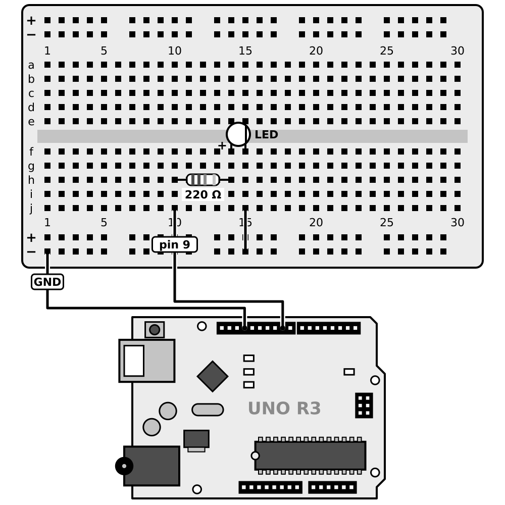
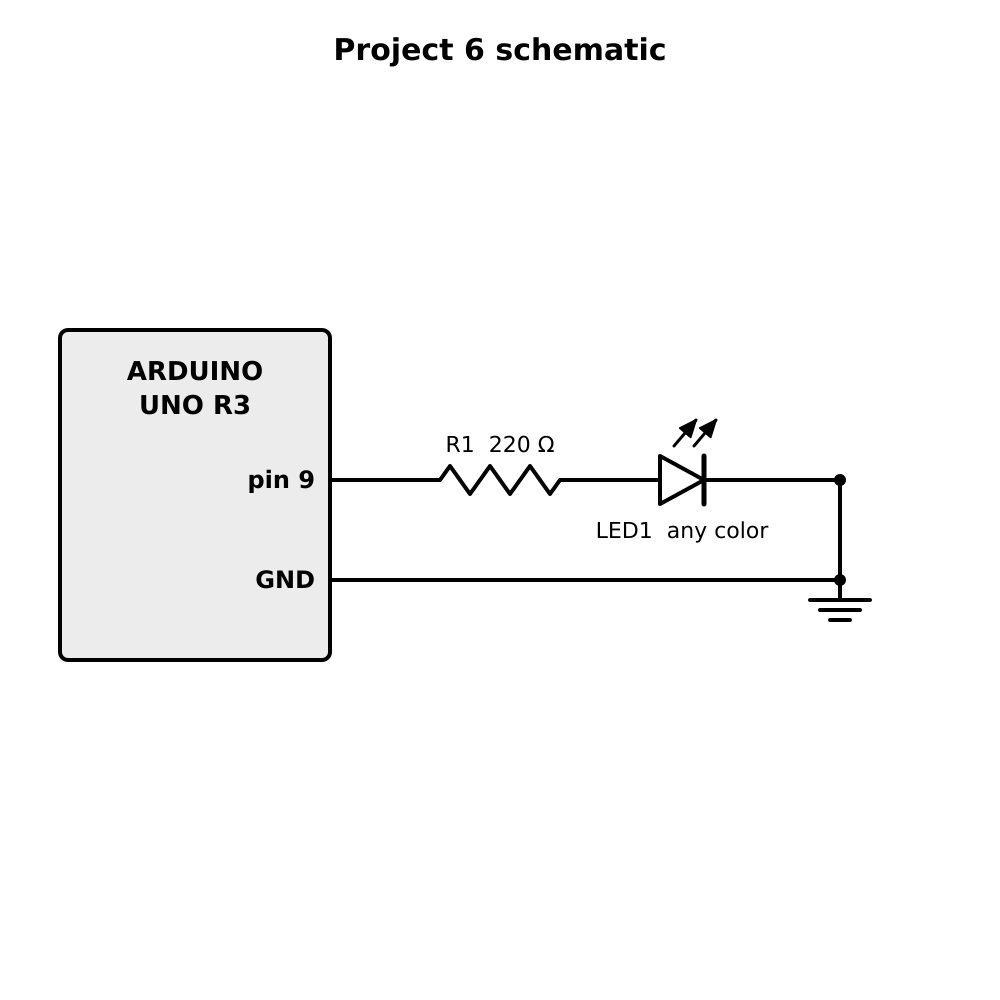

# Project 6: External LED

Book chapter: 2

## What it does

Blinks an external LED on pin 9, twice a second.

## Parts

- Arduino Uno R3 and USB cable
- 1 LED (any color)
- 1 resistor, 220 ohm
- Half-size breadboard
- 3 jumper wires

## Wiring

*Wiring diagram (book Figure 2.5)*

*Schematic (book Figure 2.6)*

- Resistor: h10 to h14
- LED: long leg f14, short leg f15
- Wire: Uno pin 9 to j10
- Wire: j15 to ground rail (minus)
- Wire: ground rail to Uno GND

## Upload
1. Open the .ino file in Arduino IDE 2.
2. Select Arduino Uno and its port.
3. Click Upload.

## What you should see

The breadboard LED is on for 500 ms, then off for 500 ms.

## Change it

Move the wire to pin 7. Then change one number in the sketch to match.
