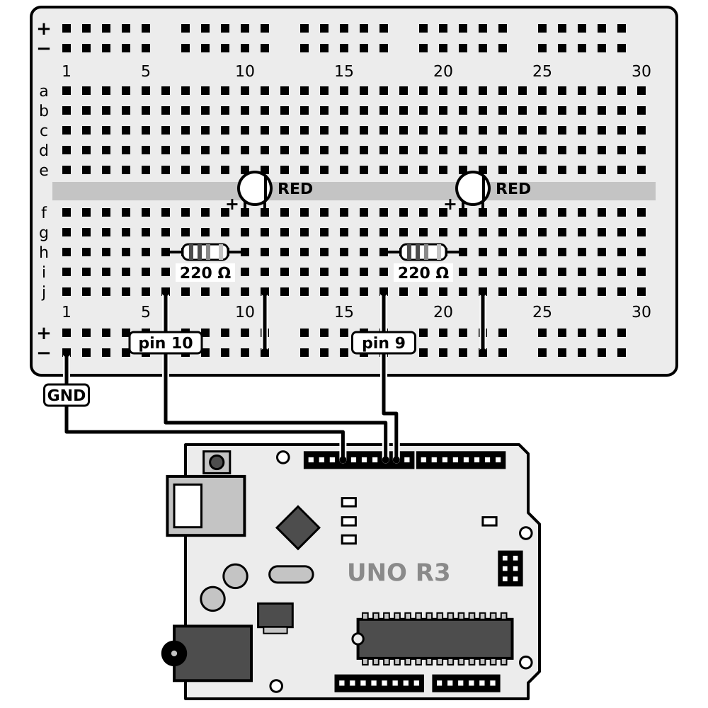
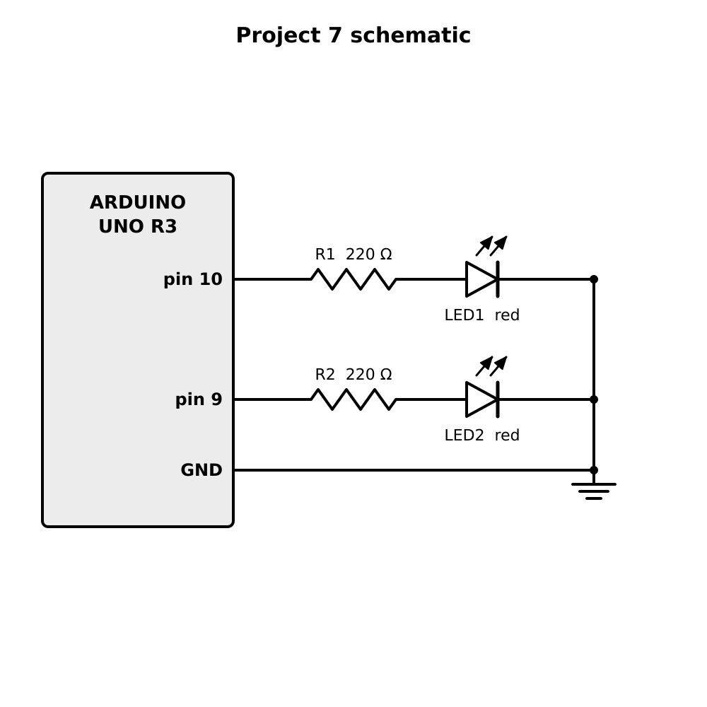

# Project 7: Alternating Pair

Book chapter: 2

## What it does

Two LEDs on pins 10 and 9 take turns, like a railroad crossing signal.

## Parts

- Arduino Uno R3 and USB cable
- 2 LEDs
- 2 resistors, 220 ohm
- Half-size breadboard
- 5 jumper wires

## Wiring

*Wiring diagram (book Figure 2.7)*

*Schematic (book Figure 2.8)*

- Resistor 1: h6 to h10
- LED 1: long leg f10, short leg f11
- Resistor 2: h17 to h21
- LED 2: long leg f21, short leg f22
- Wire: Uno pin 10 to j6
- Wire: Uno pin 9 to j17
- Wires: j11 and j22 to ground rail
- Wire: ground rail to Uno GND

## Upload
1. Open the .ino file in Arduino IDE 2.
2. Select Arduino Uno and its port.
3. Click Upload.

## What you should see

The left LED and the right LED take turns. Each one stays on for
400 ms.

## Change it

Make both lights flash together instead of taking turns.
