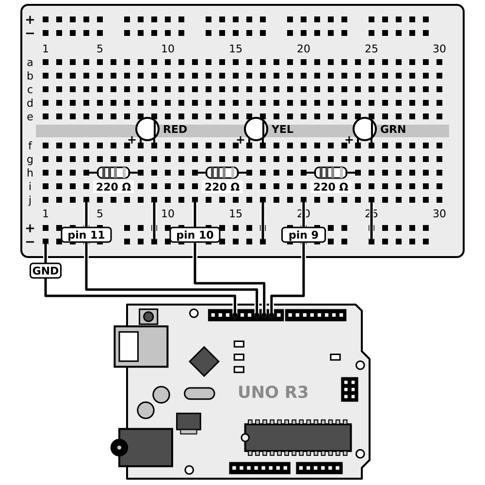
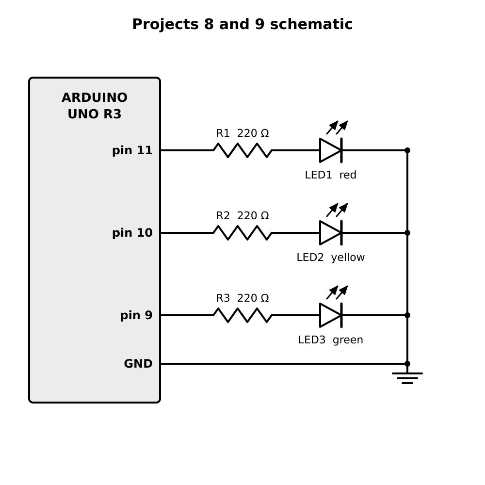

# Project 8: Traffic Light

Book chapter: 2

## What it does

A traffic light: green for 4 s, yellow for 1 s, red for 4 s. A
function called setLights() sets all three lights at once.

## Parts

- Arduino Uno R3 and USB cable
- Red, yellow, and green LEDs
- 3 resistors, 220 ohm
- Half-size breadboard
- 7 jumper wires

## Wiring

*Wiring diagram (book Figure 2.9)*

*Schematic (book Figure 2.10)*

- Resistors: h4 to h8, h12 to h16, h20 to h24
- Red LED: long leg f8, short leg f9
- Yellow LED: long leg f16, short leg f17
- Green LED: long leg f24, short leg f25
- Wires: Uno pin 11 to j4, pin 10 to j12, pin 9 to j20
- Wires: j9, j17, j25 to ground rail
- Wire: ground rail to Uno GND

## Upload
1. Open the .ino file in Arduino IDE 2.
2. Select Arduino Uno and its port.
3. Click Upload.

## What you should see

Green for 4 s, yellow for 1 s, red for 4 s. Then it repeats. Only one
LED is ever on.

## Change it

Add the European red-and-yellow state before green.
