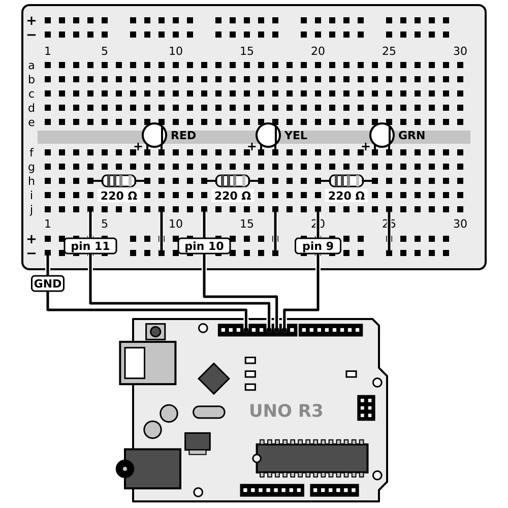
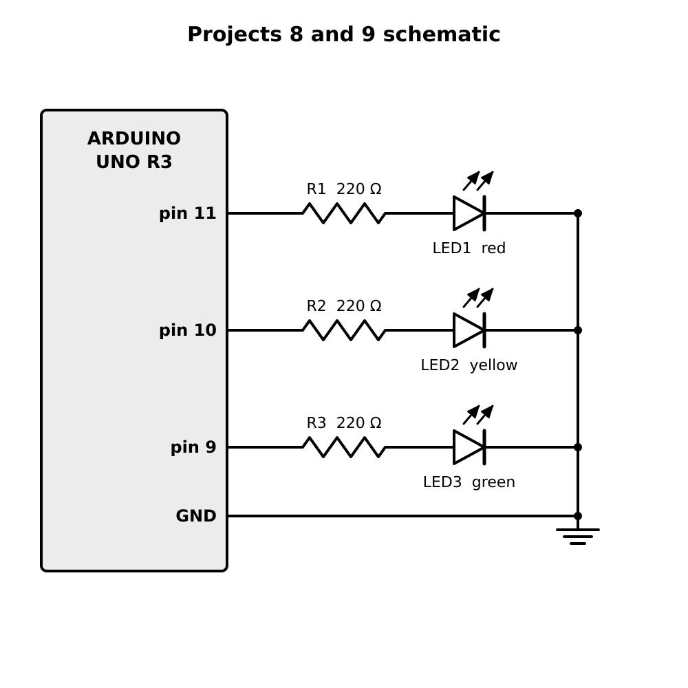

# Project 9: Stack Light

Book chapter: 2

## What it does

The Bench Creek stack light. It starts with a lamp test. Then it shows
amber for standby (3 s), green for running (6 s), and flashing red for
alarm (4 s). It prints each state name over serial at 9600 baud.

## Parts

Same circuit as [Project 8](../p008-traffic-light/):

- Arduino Uno R3 and USB cable
- Red, yellow, and green LEDs (the yellow LED is the amber light)
- 3 resistors, 220 ohm
- Half-size breadboard
- 7 jumper wires

## Wiring



*Wiring diagram (book Figure 2.9)*



*Schematic (book Figure 2.10)*

The wiring is the same as Project 8:

- Red LED on pin 11
- Amber (the yellow LED) on pin 10
- Green LED on pin 9

## Upload
1. Open the .ino file in Arduino IDE 2.
2. Select Arduino Uno and its port.
3. Click Upload.

Then open the Serial Monitor (Tools, Serial Monitor) and set it to 9600
baud.

## What you should see

All three LEDs come on for 1 s at power-up. That is the lamp test. Then:

1. Amber for 3 s
2. Green for 6 s
3. Red flashing twice a second for 4 s

Then it repeats from amber. The Serial Monitor shows:

```
STANDBY
RUNNING
ALARM
```

## Change it

Add a fault() state that flashes red and amber together.
