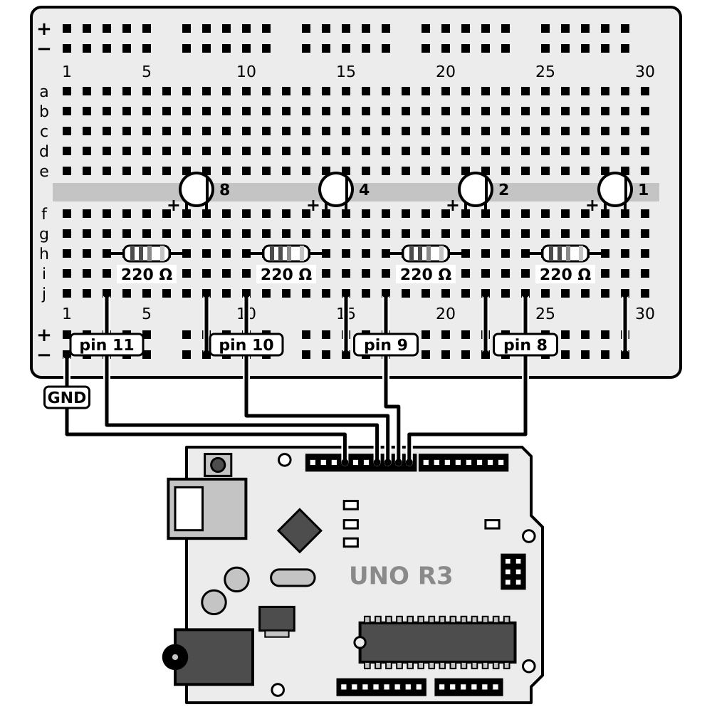
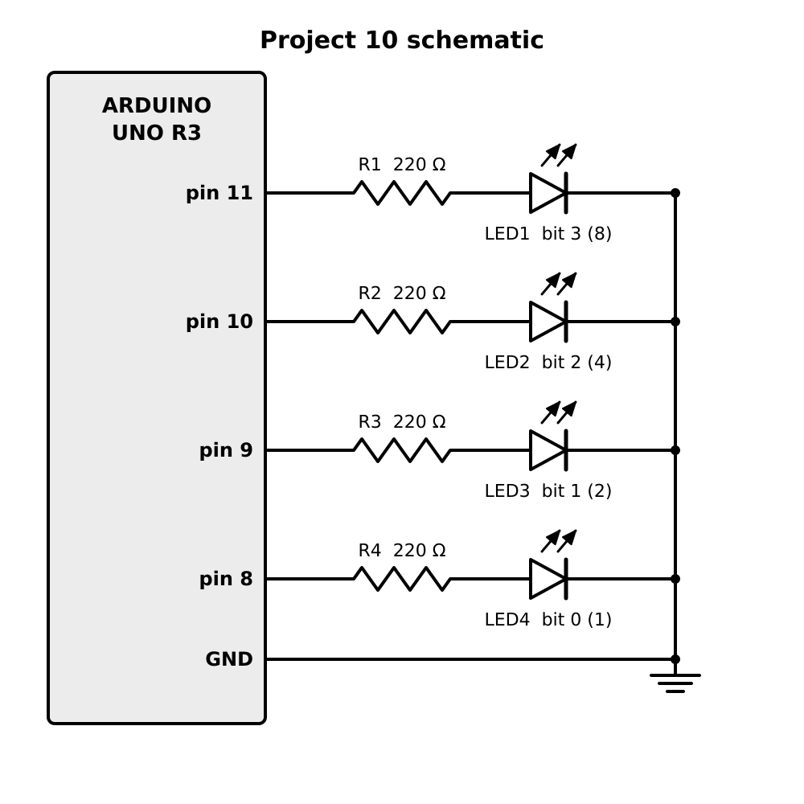

# Project 10: Binary Counter

Book chapter: 2

## What it does

Counts from 0 to 15 in binary on four LEDs. It uses bitRead() to pick
each bit. It also prints the count in decimal and in binary over serial
at 9600 baud.

## Parts

- Arduino Uno R3 and USB cable
- 4 LEDs (any color)
- 4 resistors, 220 ohm
- Half-size breadboard
- 9 jumper wires

## Wiring



*Wiring diagram (book Figure 2.14)*



*Schematic (book Figure 2.15)*

- Resistors: h3 to h7, h10 to h14, h17 to h21, h24 to h28
- LED worth 8: long leg f7, short leg f8
- LED worth 4: long leg f14, short leg f15
- LED worth 2: long leg f21, short leg f22
- LED worth 1: long leg f28, short leg f29
- Wires: Uno pin 11 to j3, pin 10 to j10, pin 9 to j17, pin 8 to j24
- Wires: j8, j15, j22, j29 to ground rail
- Wire: ground rail to Uno GND

## Upload
1. Open the .ino file in Arduino IDE 2.
2. Select Arduino Uno and its port.
3. Click Upload.

Then open the Serial Monitor (Tools, Serial Monitor) and set it to 9600
baud.

## What you should see

The LEDs count up once a second. The biggest bit, worth 8, is on the
left (pin 11). The Serial Monitor shows lines like this:

```
4 = 100
5 = 101
6 = 110
```

After 15 it goes back to 0.

## Change it

Count down from 15 to 0 instead.
