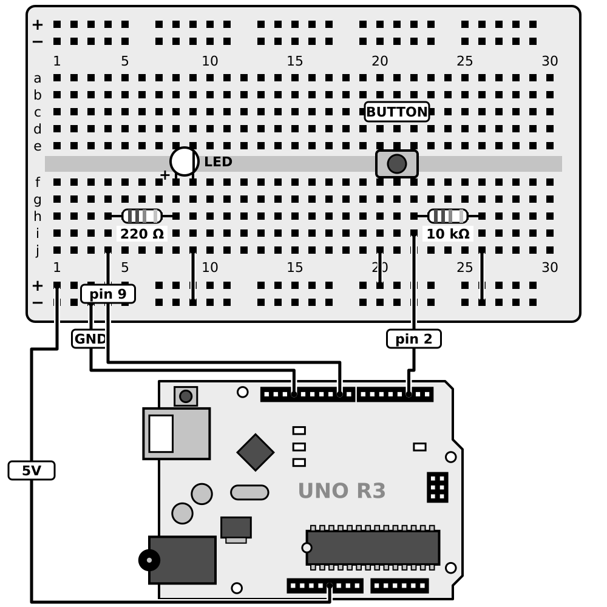
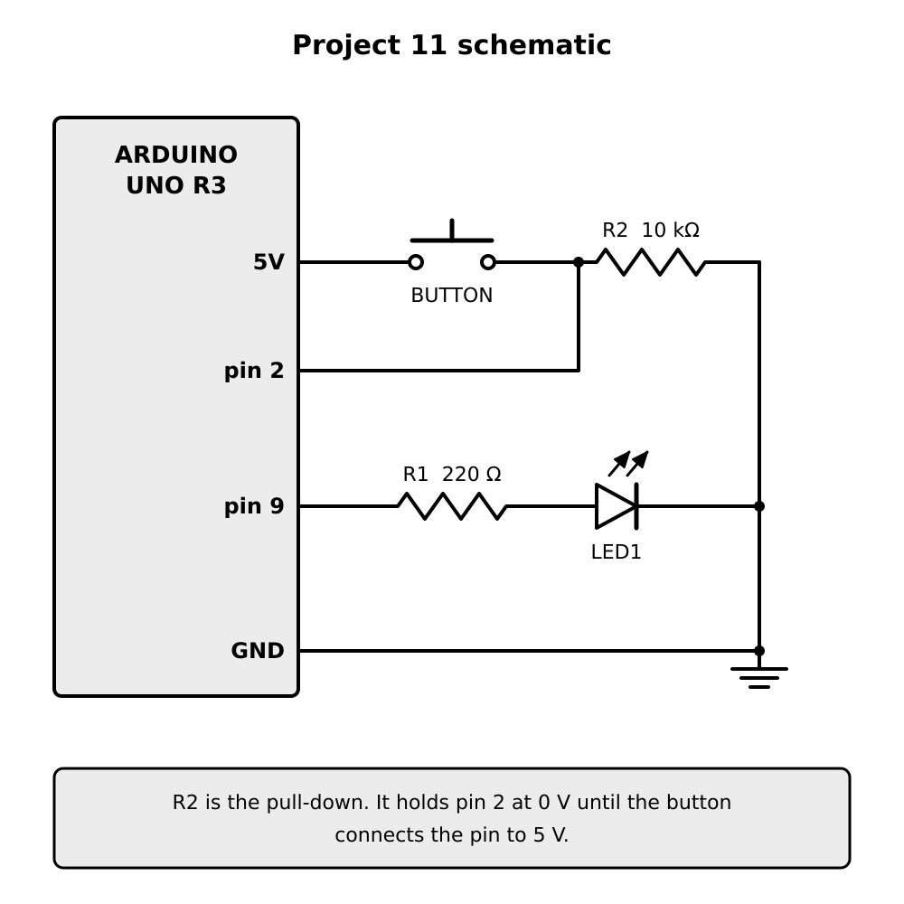

# Project 11: Button LED

Book chapter: 3

## What it does

The LED on pin 9 is lit while you hold the button on pin 2. The button
has an external 10 k pull-down resistor, so the pin uses plain INPUT.

## Parts

- Arduino Uno R3 and USB cable
- 1 pushbutton
- 1 resistor, 10 k ohm
- 1 LED
- 1 resistor, 220 ohm
- Half-size breadboard
- 7 jumper wires

## Wiring

*Wiring diagram (book Figure 3.3)*

*Schematic (book Figure 3.4)*

- Resistor 220 ohm: h4 to h8
- LED: long leg f8, short leg f9
- Pushbutton across the trench: legs e20, f20, e22, f22
- Resistor 10 k ohm: h22 to h26
- Wire: Uno pin 9 to j4
- Wire: j9 to ground rail (minus)
- Wire: Uno 5V to plus rail
- Wire: j20 to plus rail
- Wire: Uno pin 2 to i22
- Wire: j26 to ground rail
- Wire: ground rail to Uno GND

## Upload
1. Open the .ino file in Arduino IDE 2.
2. Select Arduino Uno and its port.
3. Click Upload.

## What you should see

The LED is on only while you hold the button down.

## Change it

Pull out the 10 k resistor. Watch the floating pin make the LED
flicker.
