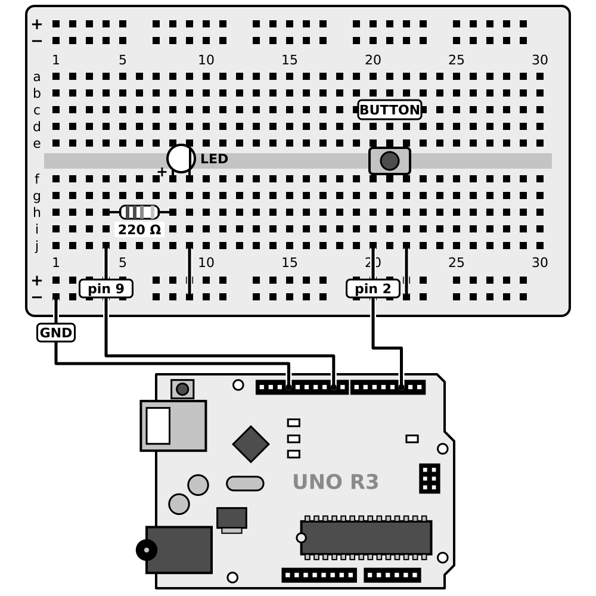
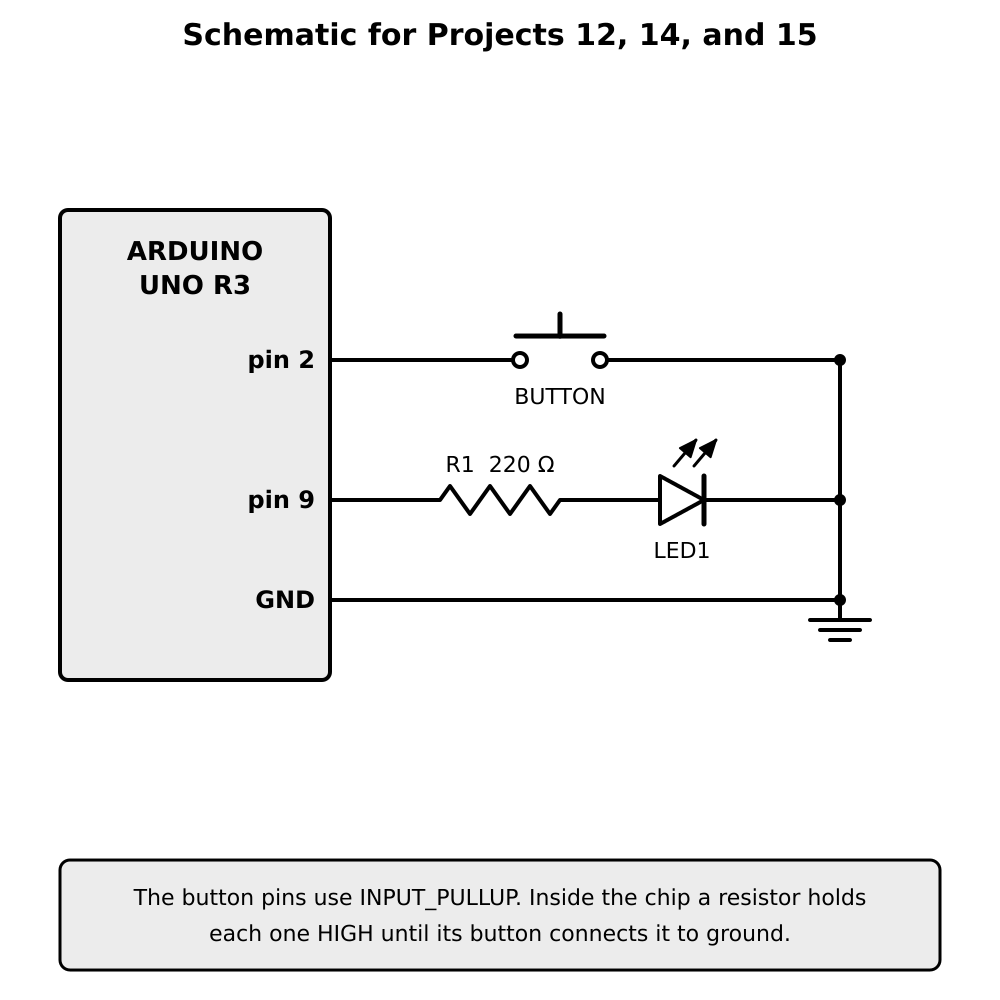

# Project 12: Internal Pull-up

Book chapter: 3

## What it does

Does the same job as [Project 11](../p011-button-led/), but uses
INPUT_PULLUP. The chip's own pull-up resistor replaces the 10 k one.
The button goes between pin 2 and ground, so a pressed button reads
LOW.

## Parts

- Arduino Uno R3 and USB cable
- 1 pushbutton
- 1 LED
- 1 resistor, 220 ohm
- Half-size breadboard
- 5 jumper wires

## Wiring

*Wiring diagram (book Figure 3.5)*

*Schematic (book Figure 3.6)*

- Resistor 220 ohm: h4 to h8
- LED: long leg f8, short leg f9
- Pushbutton across the trench: legs e20, f20, e22, f22
- Wire: Uno pin 9 to j4
- Wire: j9 to ground rail
- Wire: Uno pin 2 to j20
- Wire: j22 to ground rail
- Wire: ground rail to Uno GND

## Upload
1. Open the .ino file in Arduino IDE 2.
2. Select Arduino Uno and its port.
3. Click Upload.

## What you should see

The LED is on only while you hold the button down.

## Change it

Make the LED blink fast while the button is held.
