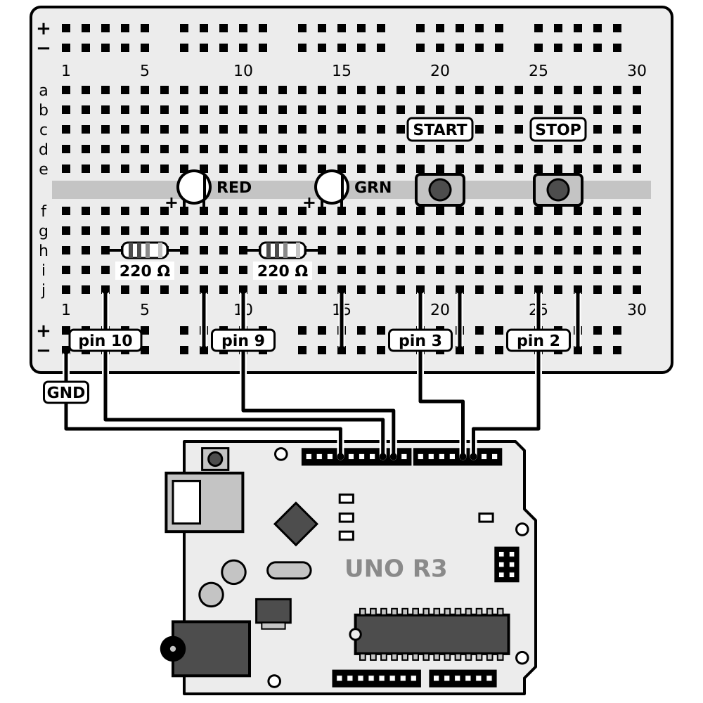
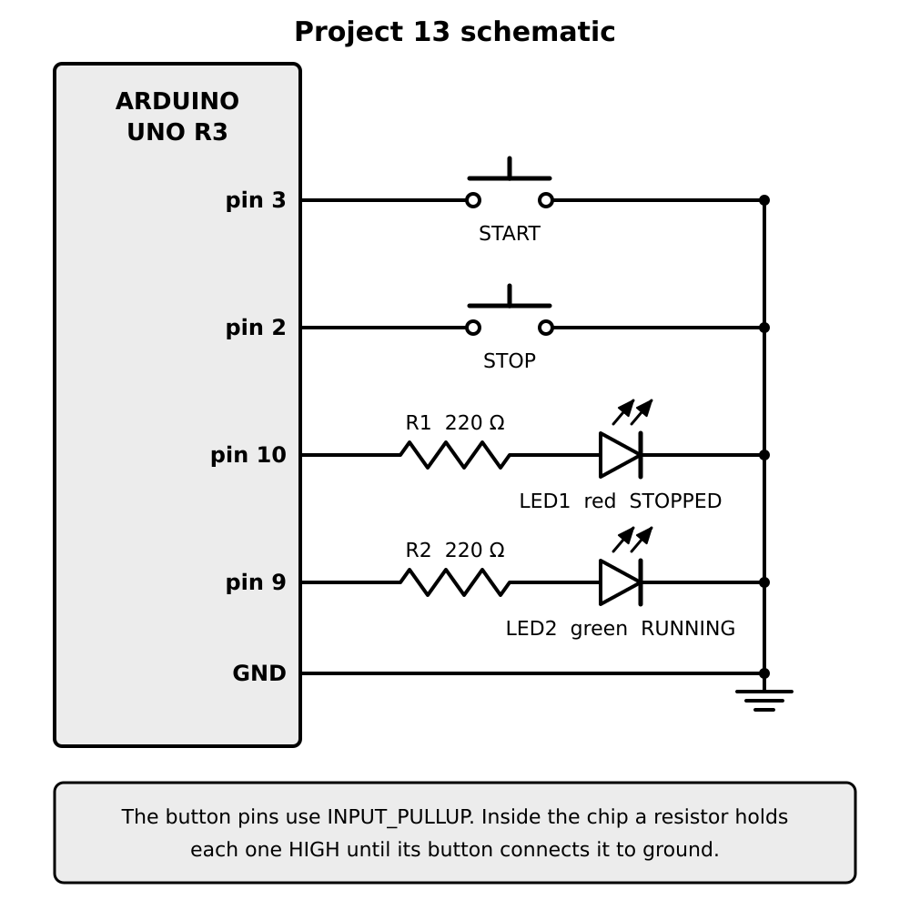

# Project 13: Start Stop Station

Book chapter: 3

## What it does

The Bench Creek pump start and stop station. START (pin 3) latches the
pump on with a seal-in line. STOP (pin 2) drops it out. If both are
pressed, STOP wins. The green lamp (pin 9) shows RUNNING and the red
lamp (pin 10) shows STOPPED. It reports each change over serial at
9600 baud.

## Parts

- Arduino Uno R3 and USB cable
- 2 pushbuttons
- 1 red LED
- 1 green LED
- 2 resistors, 220 ohm
- Half-size breadboard
- 9 jumper wires

## Wiring

*Wiring diagram (book Figure 3.8)*

*Schematic (book Figure 3.9)*

- Resistor 1: h3 to h7
- Red LED (STOPPED): long leg f7, short leg f8
- Resistor 2: h10 to h14
- Green LED (RUNNING): long leg f14, short leg f15
- START button across the trench: legs e19, f19, e21, f21
- STOP button across the trench: legs e25, f25, e27, f27
- Wires: Uno pin 10 to j3, pin 9 to j10
- Wires: Uno pin 3 to j19, pin 2 to j25
- Wires: j8, j15, j21, j27 to ground rail
- Wire: ground rail to Uno GND

## Upload
1. Open the .ino file in Arduino IDE 2.
2. Select Arduino Uno and its port.
3. Click Upload.

Then open the Serial Monitor (Tools, Serial Monitor) and set it to 9600
baud.

## What you should see

The red lamp is on at power-up.

- Tap START. Green comes on, red goes off, and "PUMP RUNNING" prints
  once.
- Tap STOP. Red comes on, green goes off, and "PUMP STOPPED" prints
  once.
- Hold STOP and press START. Nothing starts. STOP wins.

## Change it

Add a reset rule: the pump cannot start until STOP has been pressed
once since power-up.
