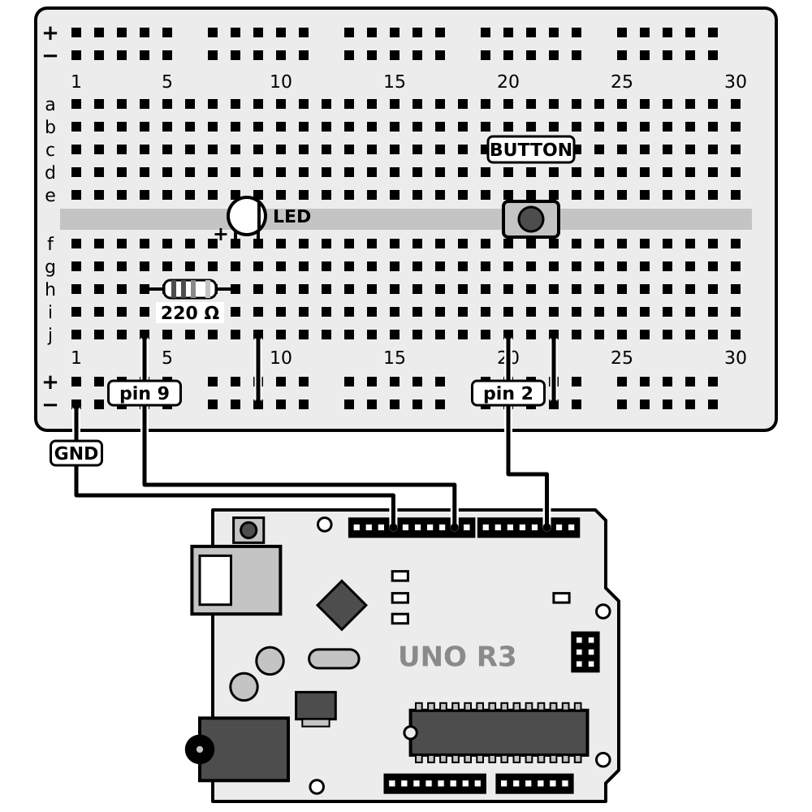
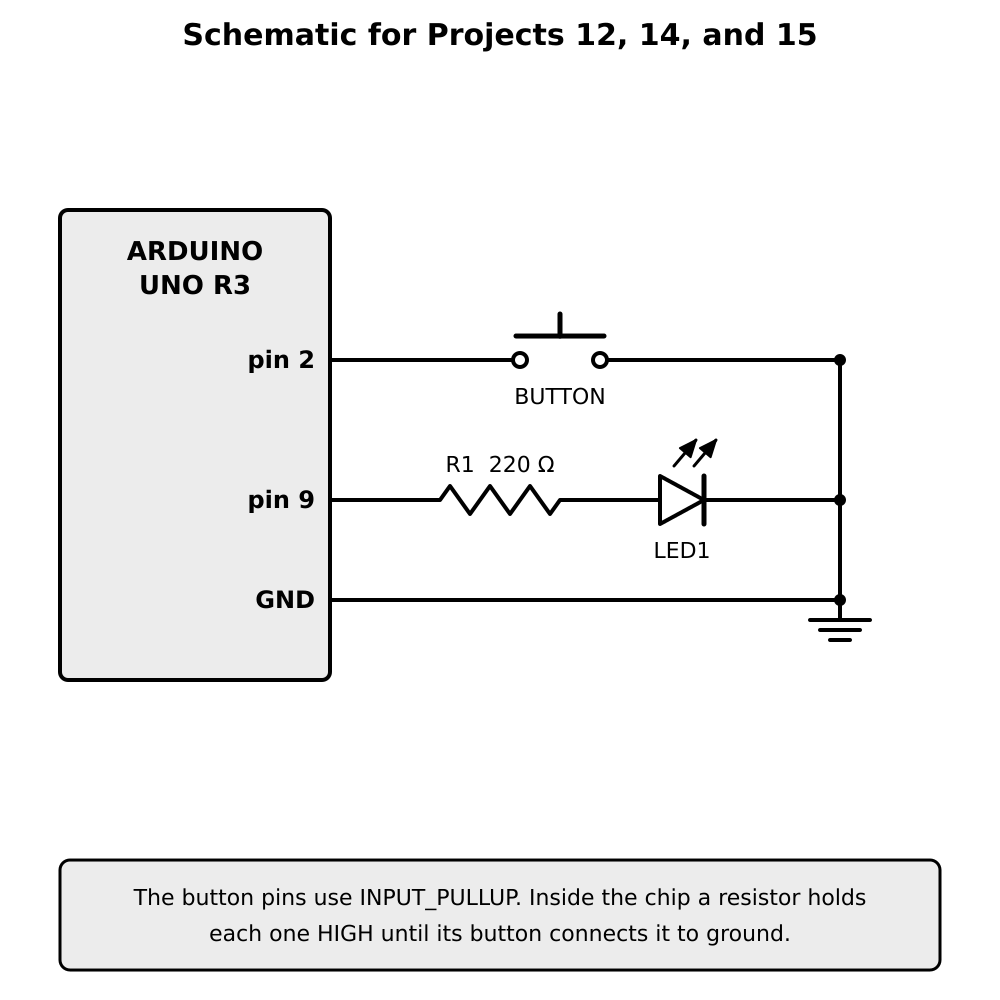

# Project 14: Press Counter

Book chapter: 3

## What it does

Counts button presses. It uses edge detection and a 20 ms debounce
delay so each press counts once. It prints the total over serial at
9600 baud. The LED is on for odd counts and off for even ones.

## Parts

Same circuit as [Project 12](../p012-internal-pull-up/):

- Arduino Uno R3 and USB cable
- 1 pushbutton
- 1 LED
- 1 resistor, 220 ohm
- Half-size breadboard
- 5 jumper wires

## Wiring



*Wiring diagram (book Figure 3.5)*



*Schematic (book Figure 3.6)*

- Resistor 220 ohm: h4 to h8
- LED: long leg f8, short leg f9
- Pushbutton across the trench: legs e20, f20, e22, f22
- Wire: Uno pin 9 to j4
- Wire: j9 to ground rail
- Wire: Uno pin 2 to j20
- Wire: j22 to ground rail
- Wire: ground rail to Uno GND

## Upload
1. Open the .ino file in Arduino IDE 2.
2. Select Arduino Uno and its port.
3. Click Upload.

Then open the Serial Monitor (Tools, Serial Monitor) and set it to 9600
baud.

## What you should see

Each press prints one line and toggles the LED:

```
Press the button
Presses: 1
Presses: 2
Presses: 3
```

## Change it

Count releases instead of presses.
