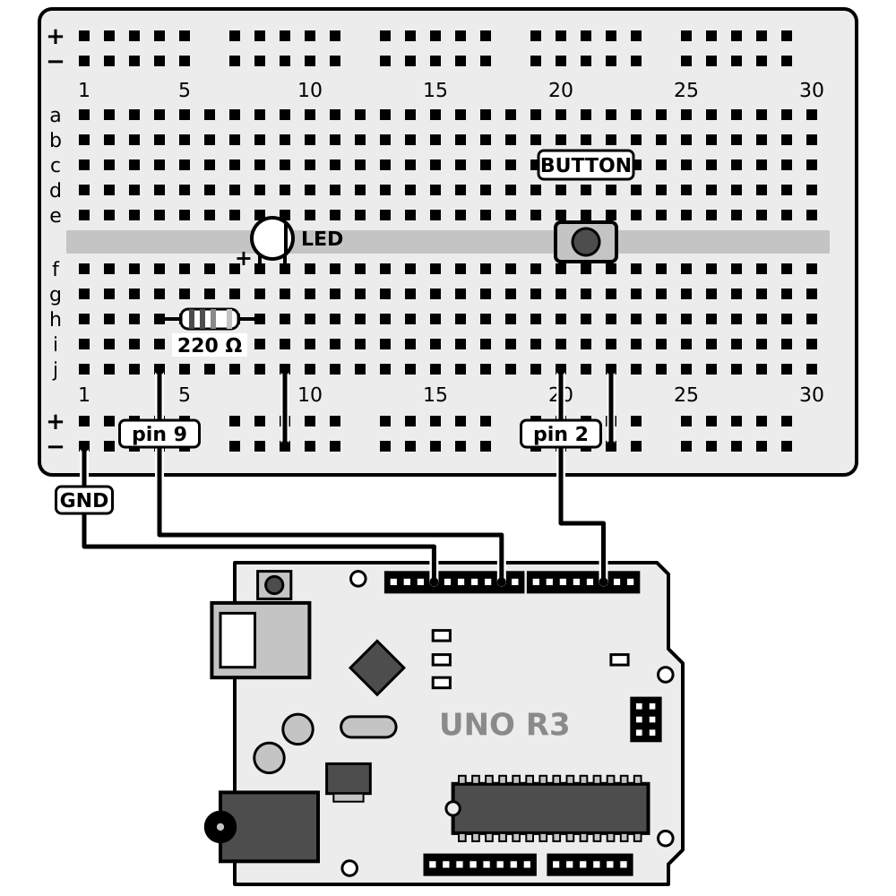
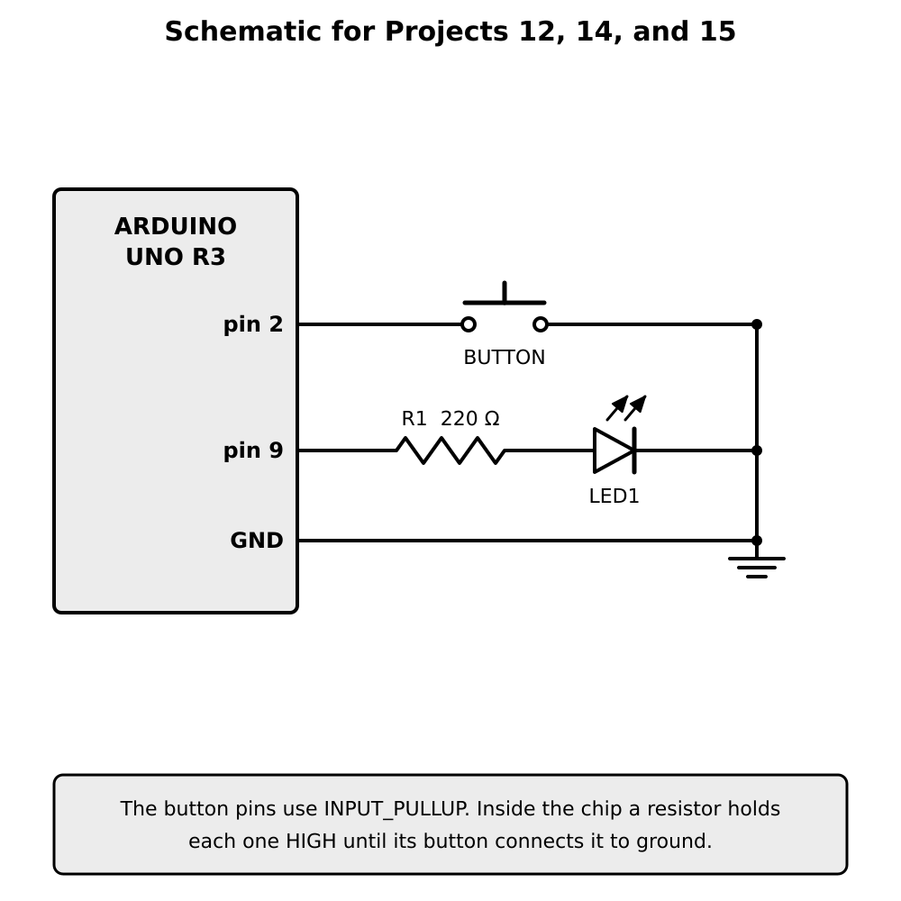

# Project 15: Reaction Timer

Book chapter: 3

## What it does

A reaction timer game. It waits a random 2 to 5 seconds, then turns
the LED on. It uses millis() to measure how long you take to press the
button. It catches false starts and keeps track of your best time.

## Parts

Same circuit as [Project 12](../p012-internal-pull-up/):

- Arduino Uno R3 and USB cable
- 1 pushbutton
- 1 LED
- 1 resistor, 220 ohm
- Half-size breadboard
- 5 jumper wires

## Wiring



*Wiring diagram (book Figure 3.5)*



*Schematic (book Figure 3.6)*

- Resistor 220 ohm: h4 to h8
- LED: long leg f8, short leg f9
- Pushbutton across the trench: legs e20, f20, e22, f22
- Wire: Uno pin 9 to j4
- Wire: j9 to ground rail
- Wire: Uno pin 2 to j20
- Wire: j22 to ground rail
- Wire: ground rail to Uno GND

## Upload
1. Open the .ino file in Arduino IDE 2.
2. Select Arduino Uno and its port.
3. Click Upload.

Then open the Serial Monitor (Tools, Serial Monitor) and set it to 9600
baud.

## What you should see

The Serial Monitor shows "Get ready...". Wait for the LED to light,
then press the button. You see your time and your best time:

```
Get ready...
Your time: 243 ms
New best!
Best so far: 243 ms
```

Your numbers will be different. "New best!" appears only when you beat
your best time.

If you press before the light, you see:

```
Too soon! Wait for the light.
```

## Change it

Make it a two-player duel. Add a second button on pin 3.
