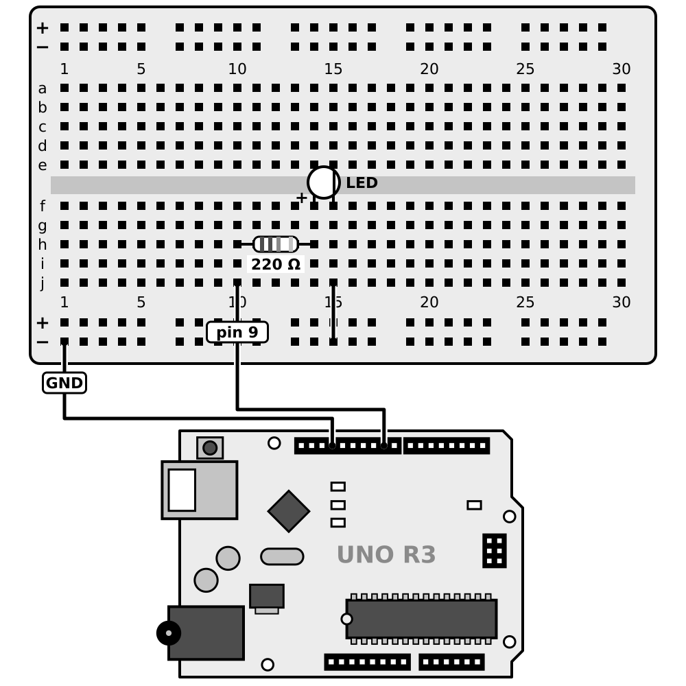
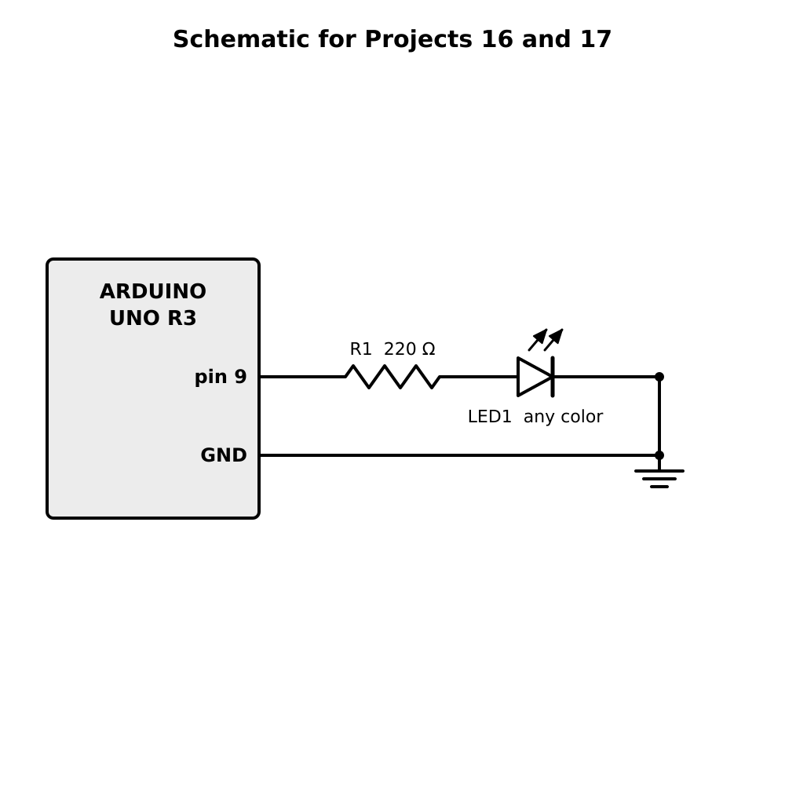

# Project 17: Breathing LED

Book chapter: 4

## What it does

A breathing LED. It squares the level (level * level / 255, as a
long) so the fade looks even, with a 700 ms rest between breaths.

## Bill of materials

Same circuit as [Project 16](../p016-fade/):

| Qty | Part | Suggested part |
|---|---|---|
| 1 | Arduino Uno R3 | Arduino A000066 |
| 1 | USB cable, type A to type B | Any USB 2.0 A-to-B cable that carries data, about 1 m |
| 1 | Breadboard, half size, 400 tie points | BusBoard BB400 |
| 1 | LED, 5 mm, any color | Kingbright WP7113ID (red) |
| 1 | Resistor, 220 ohm, 1/4 W, 5% | Yageo CFR-25JT-52-220R |
| 3 | Jumper wires, pin to pin | BusBoard ZW-MM-10 (ribbon of 40, 10 cm) |

## Wiring

*Wiring diagram (book Figure 4.3)*

*Schematic (book Figure 4.4)*

- Resistor 220 ohm: h10 to h14
- LED: long leg f14, short leg f15
- Wire: Uno pin 9 to j10
- Wire: j15 to ground rail
- Wire: ground rail to Uno GND

## Upload
1. Open the .ino file in Arduino IDE 2.
2. Select Arduino Uno and its port.
3. Click Upload.

## What you should see

A smooth rise and fall of about 1.5 s each, then a 0.7 s dark pause.

## Change it

Breathe in over one second and out over three.
