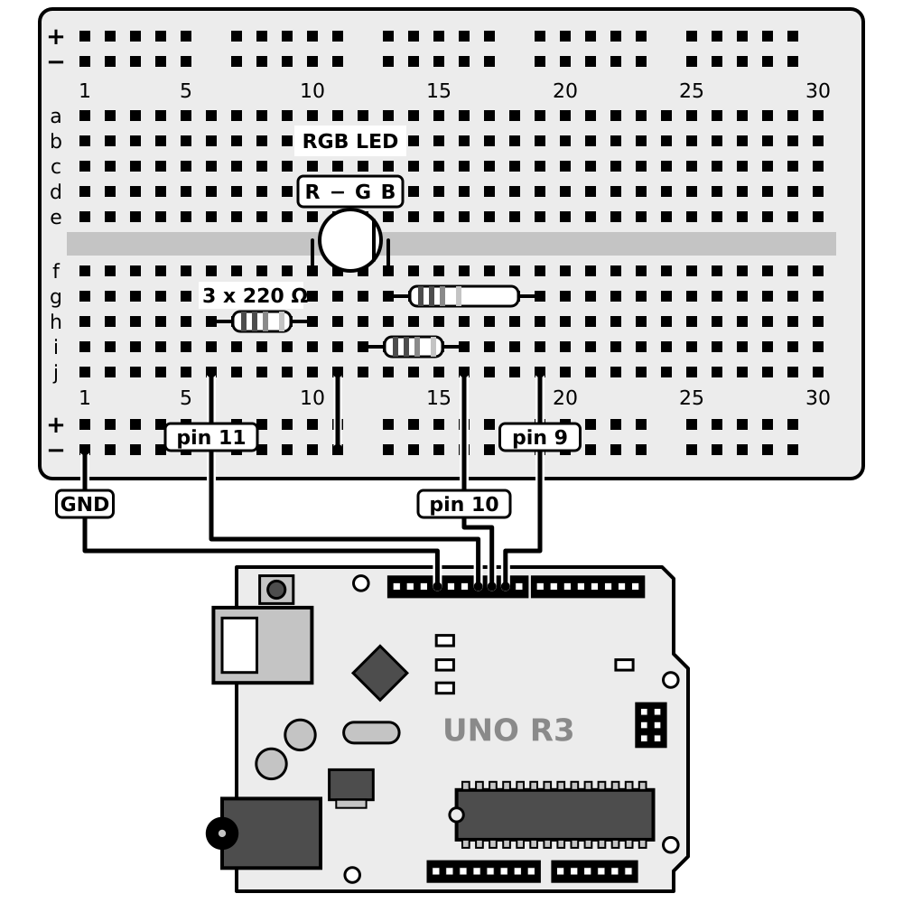
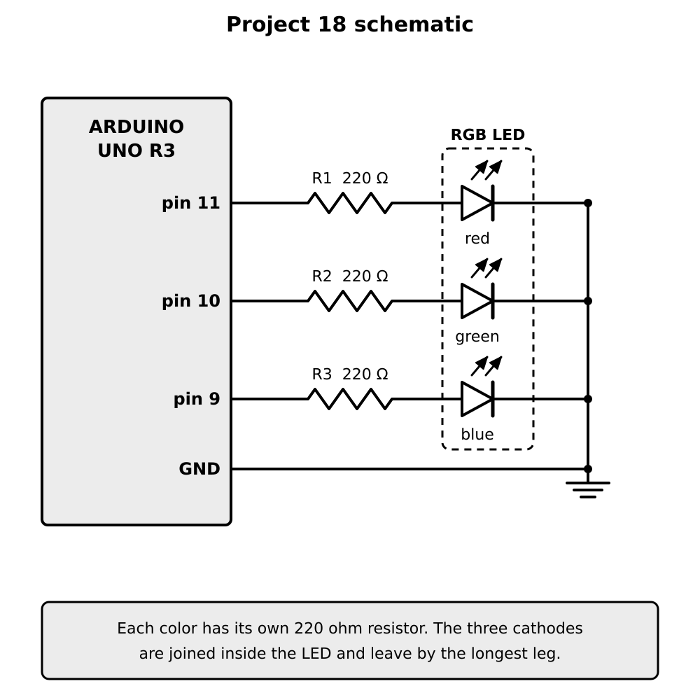

# Project 18: RGB Mixing

Book chapter: 4

## What it does

A common-cathode RGB LED on PWM pins 11 (red), 10 (green), and 9
(blue). It steps through red, green, blue, yellow, cyan, magenta,
white, orange, and off, one second each.

## Bill of materials

| Qty | Part | Suggested part |
|---|---|---|
| 1 | Arduino Uno R3 | Arduino A000066 |
| 1 | USB cable, type A to type B | Any USB 2.0 A-to-B cable that carries data, about 1 m |
| 1 | Breadboard, half size, 400 tie points | BusBoard BB400 |
| 1 | LED, RGB, 5 mm, common cathode, diffused | SparkFun COM-09264 |
| 3 | Resistor, 220 ohm, 1/4 W, 5% | Yageo CFR-25JT-52-220R |
| 5 | Jumper wires, pin to pin | BusBoard ZW-MM-10 (ribbon of 40, 10 cm) |

## Wiring

*Wiring diagram (book Figure 4.8)*

*Schematic (book Figure 4.9)*

- RGB LED (common cathode): red leg f10, longest leg f11, green leg f12, blue leg f13
- Resistor for red: h6 to h10
- Resistor for green: i12 to i16
- Resistor for blue: g13 to g19
- Wire: Uno pin 11 to j6
- Wire: Uno pin 10 to j16
- Wire: Uno pin 9 to j19
- Wire: j11 to ground rail
- Wire: ground rail to Uno GND

## Upload
1. Open the .ino file in Arduino IDE 2.
2. Select Arduino Uno and its port.
3. Click Upload.

## What you should see

Nine steps, one second each, starting red, green, blue. If the order
is wrong, your LED has a different leg order: swap the pin constants.

## Change it

Tune the white until it looks white.
