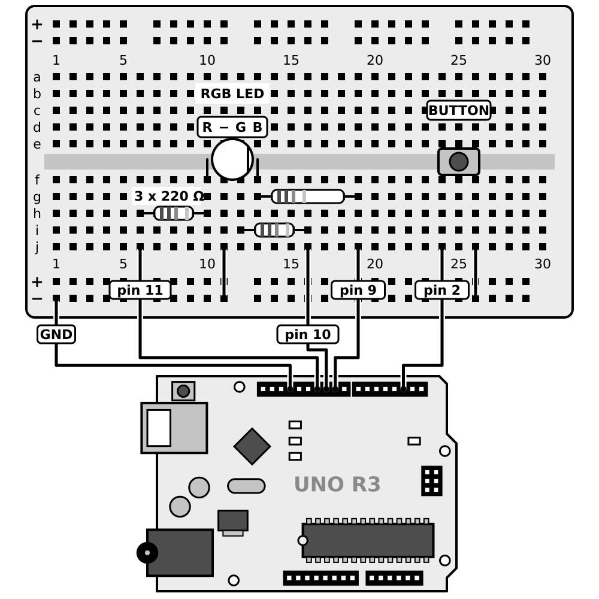
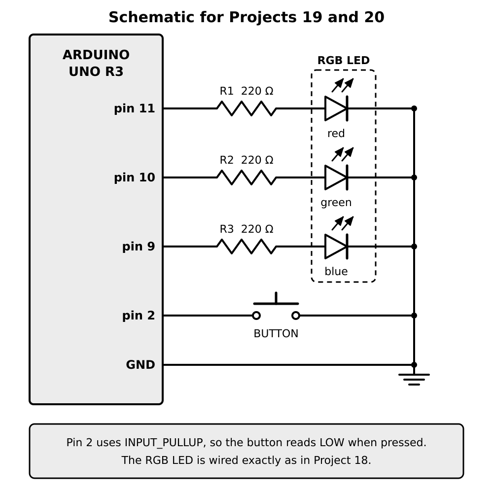

# Project 19: Mood Lamp

Book chapter: 4

## What it does

A mood lamp. It cross-fades around six color stops using fadeTo() and
stepToward(). A button on pin 2 (INPUT_PULLUP, edge detected) holds
and releases the color.

## Bill of materials

| Qty | Part | Suggested part |
|---|---|---|
| 1 | Arduino Uno R3 | Arduino A000066 |
| 1 | USB cable, type A to type B | Any USB 2.0 A-to-B cable that carries data, about 1 m |
| 1 | Breadboard, half size, 400 tie points | BusBoard BB400 |
| 1 | LED, RGB, 5 mm, common cathode, diffused | SparkFun COM-09264 |
| 3 | Resistor, 220 ohm, 1/4 W, 5% | Yageo CFR-25JT-52-220R |
| 1 | Pushbutton, tactile, 6 x 6 mm, 4 legs | Omron B3F-1000 |
| 7 | Jumper wires, pin to pin | BusBoard ZW-MM-10 (ribbon of 40, 10 cm) |

## Wiring

*Wiring diagram (book Figure 4.11)*

*Schematic (book Figure 4.12)*

- RGB LED (common cathode): red leg f10, longest leg f11, green leg f12, blue leg f13
- Resistor for red: h6 to h10
- Resistor for green: i12 to i16
- Resistor for blue: g13 to g19
- Wire: Uno pin 11 to j6
- Wire: Uno pin 10 to j16
- Wire: Uno pin 9 to j19
- Wire: j11 to ground rail
- Wire: ground rail to Uno GND
- Pushbutton across the trench: legs e24, f24, e26, f26
- Wire: Uno pin 2 to j24
- Wire: j26 to ground rail

## Upload
1. Open the .ino file in Arduino IDE 2.
2. Select Arduino Uno and its port.
3. Click Upload.

## What you should see

The color drifts red, yellow, green, cyan, blue, magenta, and back to
red in about 15 s. A press freezes the color. Another press releases
it.

## Change it

Add white as a seventh stop.
