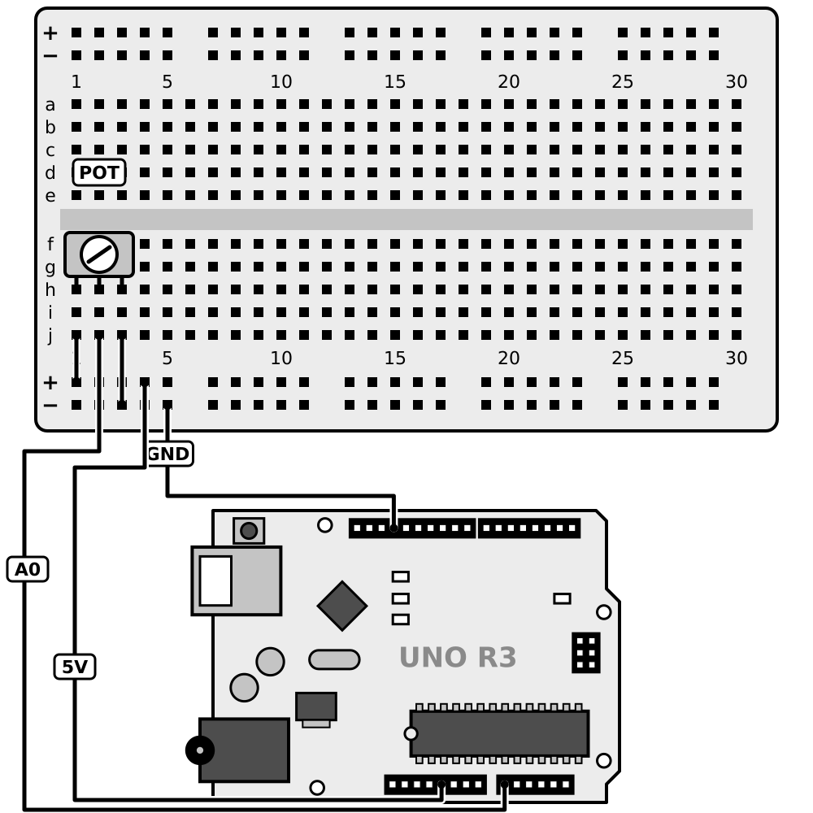
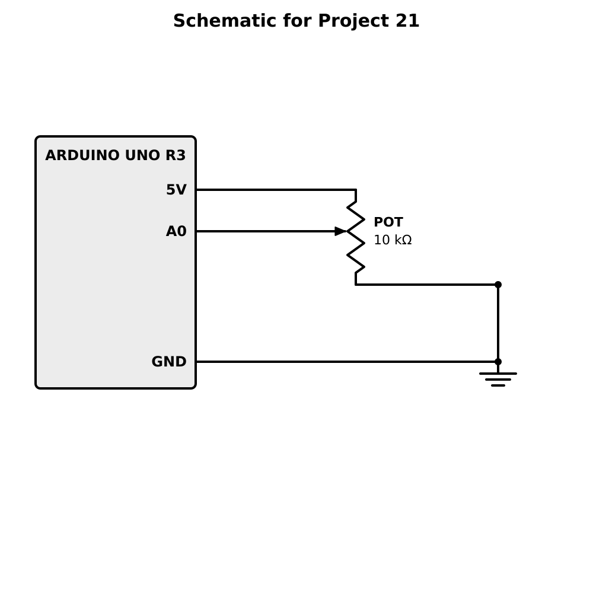

# Project 21: Pot to Serial

Book chapter: 5

## What it does

Reads a 10 k potentiometer on A0 with analogRead and prints the raw
count ten times a second.

## Bill of materials

| Qty | Part | Suggested part |
|---|---|---|
| 1 | Arduino Uno R3 | Arduino A000066 |
| 1 | USB cable, type A to type B | Any USB 2.0 A-to-B cable that carries data, about 1 m |
| 1 | Breadboard, half size, 400 tie points | BusBoard BB400 |
| 1 | Potentiometer, 10 k ohm, breadboard type, 3 legs in a row | SparkFun COM-09806 (trimpot with knob) |
| 5 | Jumper wires, pin to pin | BusBoard ZW-MM-10 (ribbon of 40, 10 cm) |

## Wiring

*Wiring diagram (book Figure 5.3)*

*Schematic (book Figure 5.4)*

- Potentiometer: three legs in h1, h2, h3, each leg in its own column
- Wires: j1 to plus rail, j3 to ground rail
- Wire: Uno pin A0 to j2
- Wire: Uno 5V to plus rail
- Wire: ground rail to Uno GND

## Upload
1. Open the .ino file in Arduino IDE 2.
2. Select Arduino Uno and its port.
3. Click Upload.

Then open the Serial Monitor (Tools, Serial Monitor) and set it to 9600
baud.

## What you should see

The Serial Monitor shows 0 at one end of the knob and 1023 at the
other. A steady knob may flicker by a count or two. If the numbers run
backwards, swap the two outer pot wires.

## Change it

Print the reading in binary and find where all ten bits are 1.
