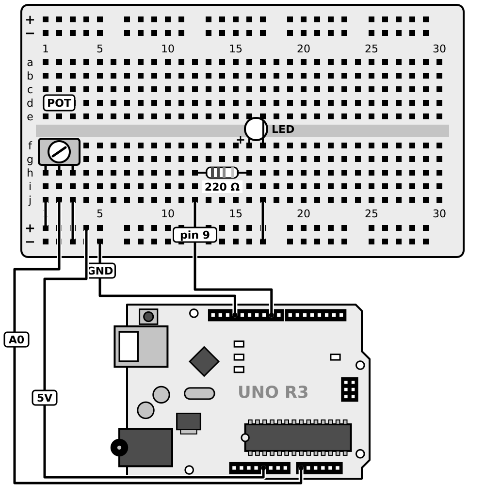
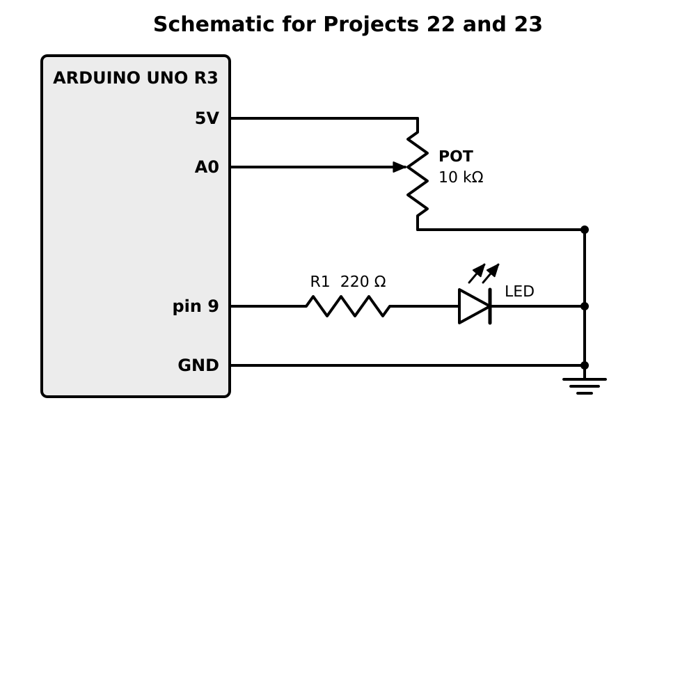

# Project 22: Dimmer

Book chapter: 5

## What it does

A dimmer. It scales the A0 reading to 0 to 255 with map() and writes
it to the LED on PWM pin 9. It prints the raw reading and the level.

## Bill of materials

| Qty | Part | Suggested part |
|---|---|---|
| 1 | Arduino Uno R3 | Arduino A000066 |
| 1 | USB cable, type A to type B | Any USB 2.0 A-to-B cable that carries data, about 1 m |
| 1 | Breadboard, half size, 400 tie points | BusBoard BB400 |
| 1 | Potentiometer, 10 k ohm, breadboard type, 3 legs in a row | SparkFun COM-09806 (trimpot with knob) |
| 1 | LED, 5 mm, any color | Kingbright WP7113ID (red) |
| 1 | Resistor, 220 ohm, 1/4 W, 5% | Yageo CFR-25JT-52-220R |
| 7 | Jumper wires, pin to pin | BusBoard ZW-MM-10 (ribbon of 40, 10 cm) |

## Wiring



*Wiring diagram (book Figure 5.5)*



*Schematic (book Figure 5.6)*

- Potentiometer: three legs in h1, h2, h3, each leg in its own column
- Wires: j1 to plus rail, j3 to ground rail
- Wire: Uno pin A0 to j2
- Wire: Uno 5V to plus rail
- Wire: ground rail to Uno GND
- Resistor 220 ohm: h12 to h16
- LED: long leg f16, short leg f17
- Wire: Uno pin 9 to j12
- Wire: j17 to ground rail

## Upload
1. Open the .ino file in Arduino IDE 2.
2. Select Arduino Uno and its port.
3. Click Upload.

Then open the Serial Monitor (Tools, Serial Monitor) and set it to 9600
baud.

## What you should see

The LED goes smoothly from off to full across the turn of the knob.
The Serial Monitor shows lines such as:

```
512 -> 127
```

## Change it

Reverse the dimmer by changing only the last two numbers in the map
line.
