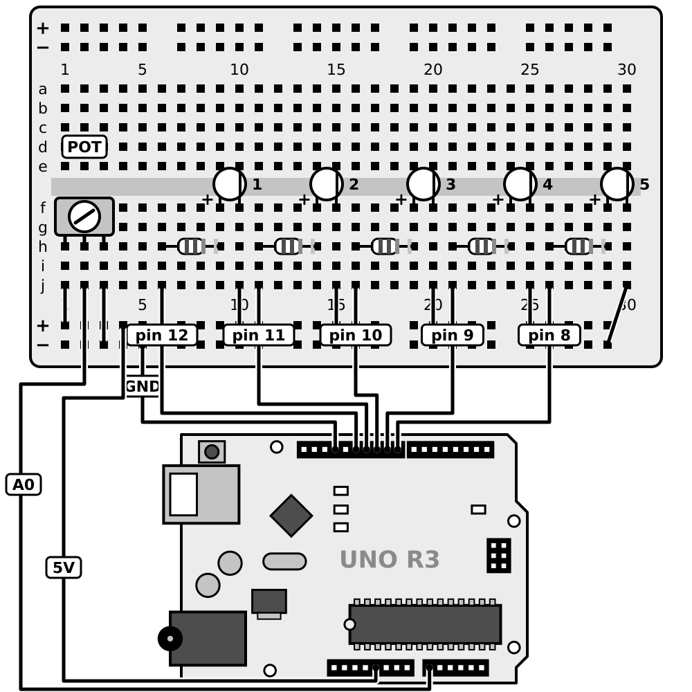
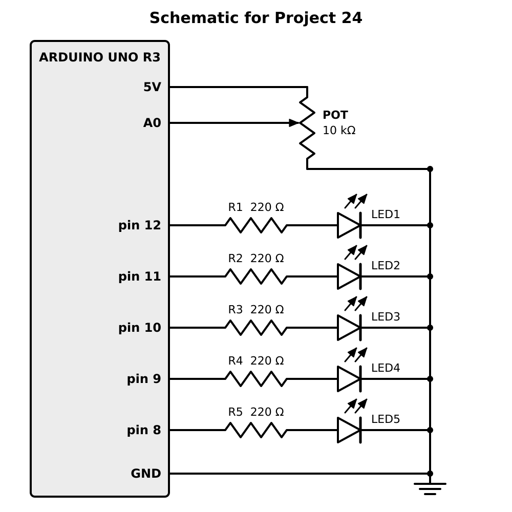

# Project 24: Bar Graph

Book chapter: 5

## What it does

A bar graph. Five LEDs on pins 12, 11, 10, 9, and 8 switch on at 10,
30, 50, 70, and 90 percent of the knob. It uses no arrays (they come in
Chapter 15).

## Bill of materials

| Qty | Part | Suggested part |
|---|---|---|
| 1 | Arduino Uno R3 | Arduino A000066 |
| 1 | USB cable, type A to type B | Any USB 2.0 A-to-B cable that carries data, about 1 m |
| 1 | Breadboard, half size, 400 tie points | BusBoard BB400 |
| 1 | Potentiometer, 10 k ohm, breadboard type, 3 legs in a row | SparkFun COM-09806 (trimpot with knob) |
| 5 | LED, 5 mm, any color | Kingbright WP7113ID (red) |
| 5 | Resistor, 220 ohm, 1/4 W, 5% | Yageo CFR-25JT-52-220R |
| 15 | Jumper wires, pin to pin | BusBoard ZW-MM-10 (ribbon of 40, 10 cm) |

## Wiring

*Wiring diagram (book Figure 5.9)*

*Schematic (book Figure 5.10)*

- Potentiometer: three legs in h1, h2, h3, each leg in its own column
- Wires: j1 to plus rail, j3 to ground rail
- Wire: Uno pin A0 to j2
- Wire: Uno 5V to plus rail
- Wire: ground rail to Uno GND
- Resistors 220 ohm: h6 to h9, h11 to h14, h16 to h19, h21 to h24, h26 to h29
- LED 1: long leg f9, short leg f10
- LED 2: long leg f14, short leg f15
- LED 3: long leg f19, short leg f20
- LED 4: long leg f24, short leg f25
- LED 5: long leg f29, short leg f30
- Wires: Uno pin 12 to j6, pin 11 to j11, pin 10 to j16, pin 9 to j21, pin 8 to j26
- Wires: j10, j15, j20, j25, j30 to ground rail

## Upload
1. Open the .ino file in Arduino IDE 2.
2. Select Arduino Uno and its port.
3. Click Upload.

## What you should see

The bar grows one LED at a time as the knob turns up and shrinks as it
turns down.

## Change it

Make it a dot instead of a bar: only the highest qualifying LED is
lit.
