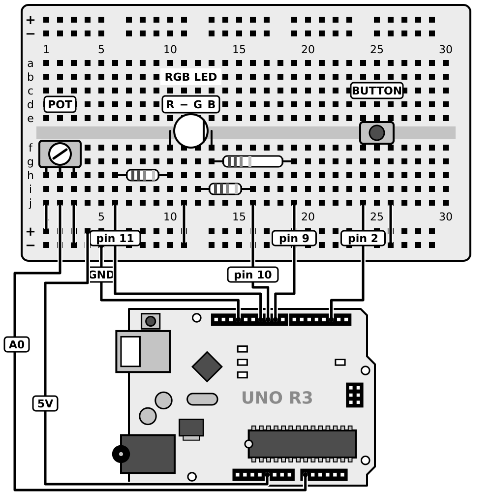
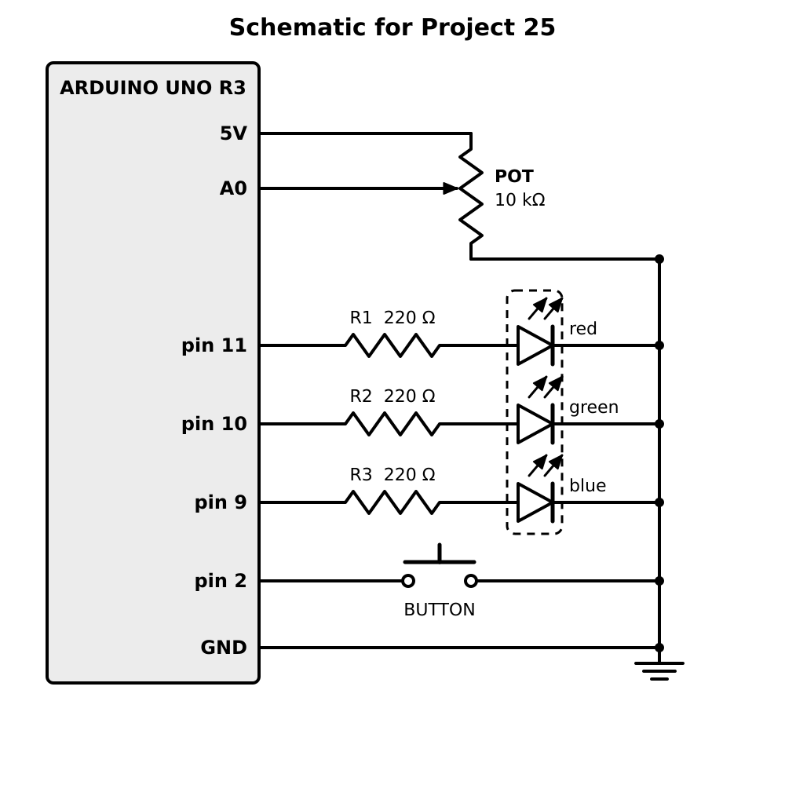

# Project 25: Pot RGB Mixer

Book chapter: 5

## What it does

A pot RGB mixer. One pot on A0 sets one color of a common-cathode RGB
LED (pins 11, 10, 9) at a time. A button on pin 2 (INPUT_PULLUP, edge
detected) moves the knob to the next color with
selected = (selected + 1) % 3. It prints the mix on each press.

## Bill of materials

| Qty | Part | Suggested part |
|---|---|---|
| 1 | Arduino Uno R3 | Arduino A000066 |
| 1 | USB cable, type A to type B | Any USB 2.0 A-to-B cable that carries data, about 1 m |
| 1 | Breadboard, half size, 400 tie points | BusBoard BB400 |
| 1 | Potentiometer, 10 k ohm, breadboard type, 3 legs in a row | SparkFun COM-09806 (trimpot with knob) |
| 1 | LED, RGB, 5 mm, common cathode, diffused | SparkFun COM-09264 |
| 3 | Resistor, 220 ohm, 1/4 W, 5% | Yageo CFR-25JT-52-220R |
| 1 | Pushbutton, tactile, 6 x 6 mm, 4 legs | Omron B3F-1000 |
| 11 | Jumper wires, pin to pin | BusBoard ZW-MM-10 (ribbon of 40, 10 cm) |

## Wiring



*Wiring diagram (book Figure 5.12)*



*Schematic (book Figure 5.13)*

- Potentiometer: three legs in h1, h2, h3, each leg in its own column
- Wires: j1 to plus rail, j3 to ground rail
- Wire: Uno pin A0 to j2
- Wire: Uno 5V to plus rail
- Wire: ground rail to Uno GND
- RGB LED (common cathode): red leg f10, longest leg f11, green leg f12, blue leg f13
- Resistors 220 ohm: h6 to h10 (red), i12 to i16 (green), g13 to g19 (blue)
- Pushbutton across the trench: legs e24, f24, e26, f26
- Wires: Uno pin 11 to j6, pin 10 to j16, pin 9 to j19
- Wire: j11 to ground rail
- Wire: Uno pin 2 to j24
- Wire: j26 to ground rail

## Upload
1. Open the .ino file in Arduino IDE 2.
2. Select Arduino Uno and its port.
3. Click Upload.

Then open the Serial Monitor (Tools, Serial Monitor) and set it to 9600
baud.

## What you should see

The knob sets red. Each press prints the mix and hands the knob to
green, then blue, then red again:

```
mix 0, 0, 0   knob now sets RED
mix 200, 0, 0   knob now sets GREEN
```

Your numbers will be different. The newly selected color jumps to the
knob position. That is intended and is discussed in the book.

## Change it

Remove the jump: after a press, ignore the knob until it comes within
5 of the stored setting.
