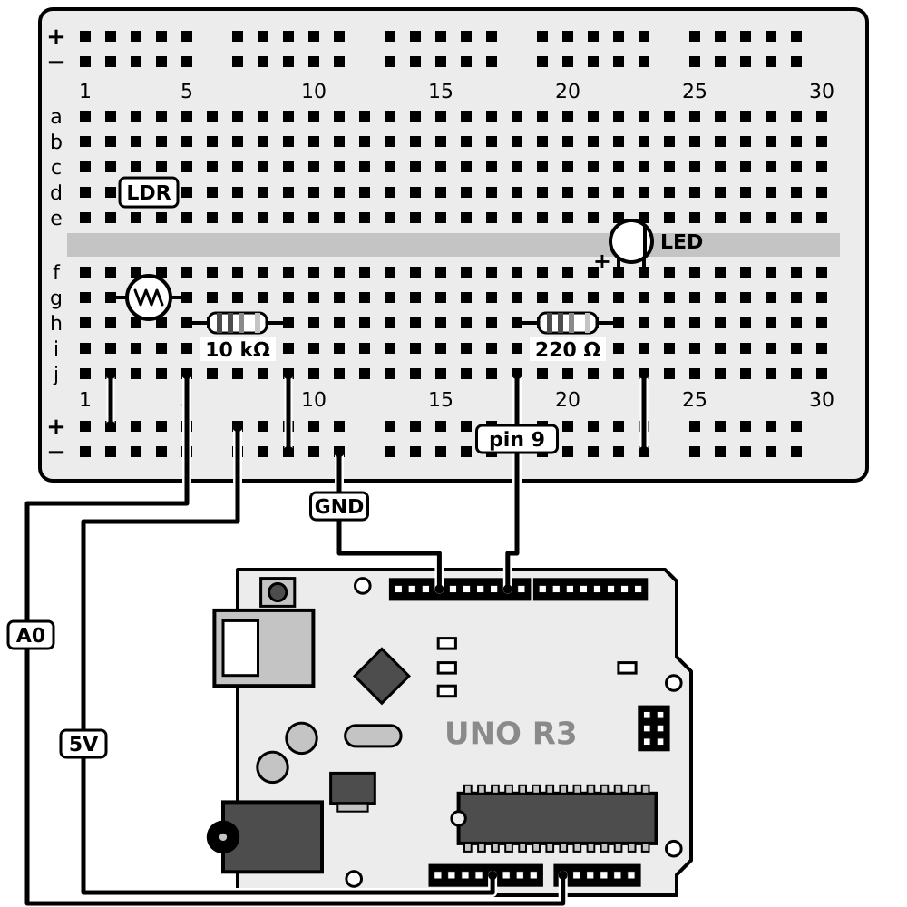
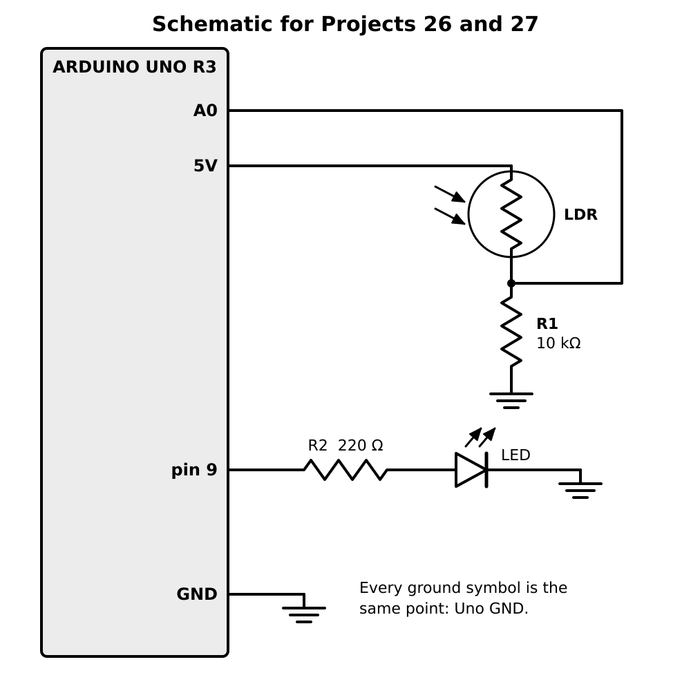

# Project 26: Night Light

Book chapter: 6

## What it does

A night light. An LDR and a 10 k resistor form a voltage divider on A0
(more light gives a higher reading). map() with a reversed output range
and constrain() turn the reading into a PWM level for the LED on pin 9.
DARK and BRIGHT are calibration constants you measure yourself.

## Bill of materials

| Qty | Part | Suggested part |
|---|---|---|
| 1 | Arduino Uno R3 | Arduino A000066 |
| 1 | USB cable, type A to type B | Any USB 2.0 A-to-B cable that carries data, about 1 m |
| 1 | Breadboard, half size, 400 tie points | BusBoard BB400 |
| 1 | Photocell (light dependent resistor, LDR), 2 legs | SparkFun SEN-09088 (mini photocell) |
| 1 | Resistor, 10 k ohm, 1/4 W, 5% | Yageo CFR-25JT-52-10K |
| 1 | LED, 5 mm, any color | Kingbright WP7113ID (red) |
| 1 | Resistor, 220 ohm, 1/4 W, 5% | Yageo CFR-25JT-52-220R |
| 7 | Jumper wires, pin to pin | BusBoard ZW-MM-10 (ribbon of 40, 10 cm) |

## Wiring



*Wiring diagram (book Figure 6.2)*



*Schematic (book Figure 6.3)*

- LDR (photocell): one leg in g2, the other in g5
- Resistor 10 k ohm: h5 to h9
- Wires: j2 to plus rail, j9 to ground rail
- Wire: Uno pin A0 to j5
- Wire: Uno 5V to plus rail
- Wire: ground rail to Uno GND
- Resistor 220 ohm: h18 to h22
- LED: long leg f22, short leg f23
- Wire: Uno pin 9 to j18
- Wire: j23 to ground rail

## Upload
1. Open the .ino file in Arduino IDE 2.
2. Select Arduino Uno and its port.
3. Click Upload.

Then open the Serial Monitor (Tools, Serial Monitor) and set it to 9600
baud.

## What you should see

The LED is off in room light, glows as you shade the LDR, and is full
when you cover it. The Serial Monitor shows lines such as:

```
450 -> 128
```

Replace DARK (200) and BRIGHT (700) in the sketch with your own
readings: one with the sensor covered, one in normal room light.

## Change it

Make it a day light: brightest when the room is brightest.
