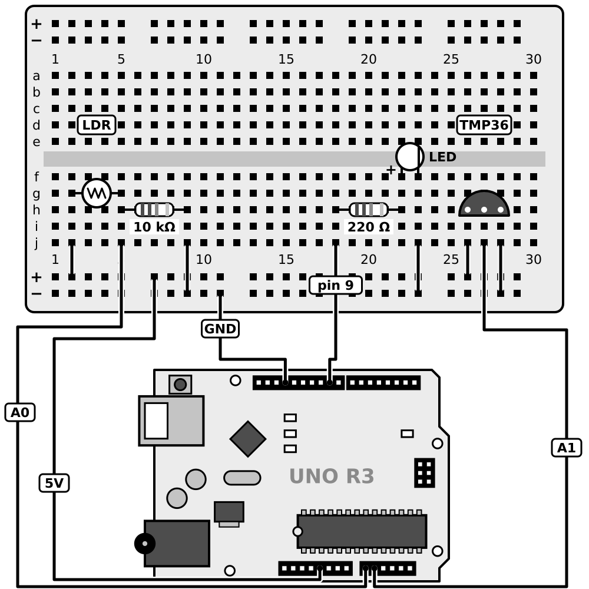
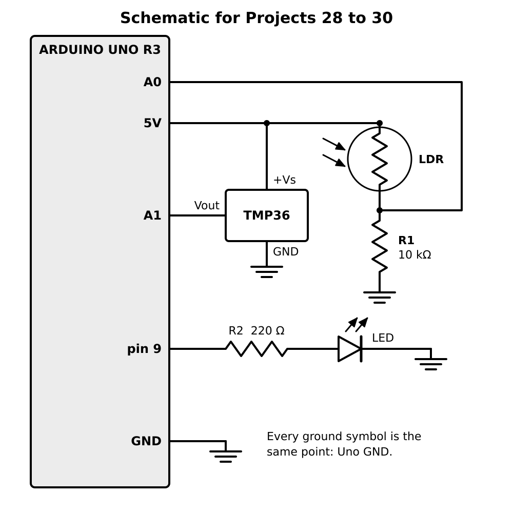

# Project 28: TMP36 Thermometer

Book chapter: 6

## What it does

A TMP36 thermometer on A1. It averages 16 readings, converts counts to
volts, then degC = (volts - 0.5) * 100, then Fahrenheit.

## Bill of materials

| Qty | Part | Suggested part |
|---|---|---|
| 1 | Arduino Uno R3 | Arduino A000066 |
| 1 | USB cable, type A to type B | Any USB 2.0 A-to-B cable that carries data, about 1 m |
| 1 | Breadboard, half size, 400 tie points | BusBoard BB400 |
| 1 | Temperature sensor, TMP36, TO-92 package, 3 legs | Analog Devices TMP36GT9Z |
| 5 | Jumper wires, pin to pin | BusBoard ZW-MM-10 (ribbon of 40, 10 cm) |

## Wiring

**Safety:** if the TMP36 is in backwards it gets hot enough to burn.
If it feels hot, unplug the USB cable first, then let it cool before
you touch it.



*Wiring diagram (book Figure 6.7)*



*Schematic (book Figure 6.8)*

The drawing shows the full Chapter 6 circuit. The LDR and LED parts are
left on the board from the earlier projects; this sketch does not use
them, so they are not in the bill of materials above.

- TMP36: legs in h26, h27, h28, flat face toward row j (left leg +Vs, middle Vout, right GND)
- Wires: j26 to plus rail, j28 to ground rail
- Wire: Uno pin A1 to j27
- Wire: Uno 5V to plus rail
- Wire: ground rail to Uno GND

## Upload
1. Open the .ino file in Arduino IDE 2.
2. Select Arduino Uno and its port.
3. Click Upload.

Then open the Serial Monitor (Tools, Serial Monitor) and set it to 9600
baud.

## What you should see

Two lines a second, such as:

```
0.733 V  23.3 C  74.0 F
```

Pinching the sensor raises the reading. The value moves in steps of
about half a degree C. That is the resolution of the analog input, and
the book explains it.

## Change it

Add a calibration constant OFFSET and add it to degC.
