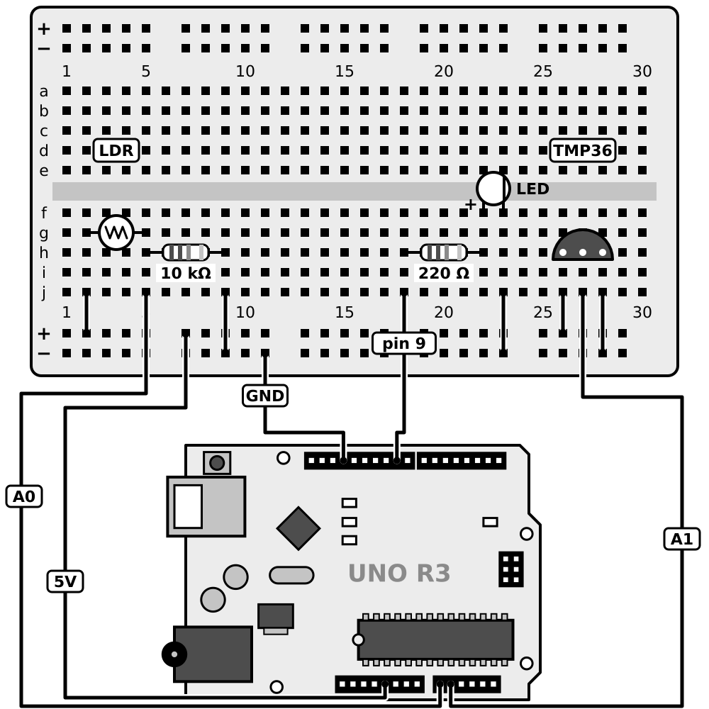
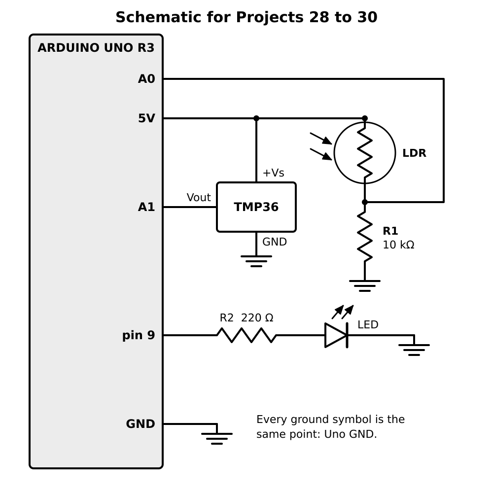

# Project 29: High Alarm with Deadband

Book chapter: 6

## What it does

A high temperature alarm with a deadband. The alarm lamp on pin 9 turns
on above ALARM_ON (27.0 C) and off below ALARM_OFF (26.0 C). Between
the limits, the bool alarm keeps its state. Set the limits from your
own room temperature.

## Bill of materials

| Qty | Part | Suggested part |
|---|---|---|
| 1 | Arduino Uno R3 | Arduino A000066 |
| 1 | USB cable, type A to type B | Any USB 2.0 A-to-B cable that carries data, about 1 m |
| 1 | Breadboard, half size, 400 tie points | BusBoard BB400 |
| 1 | Temperature sensor, TMP36, TO-92 package, 3 legs | Analog Devices TMP36GT9Z |
| 1 | LED, 5 mm, any color | Kingbright WP7113ID (red) |
| 1 | Resistor, 220 ohm, 1/4 W, 5% | Yageo CFR-25JT-52-220R |
| 7 | Jumper wires, pin to pin | BusBoard ZW-MM-10 (ribbon of 40, 10 cm) |

## Wiring



*Wiring diagram (book Figure 6.7)*



*Schematic (book Figure 6.8)*

The drawing shows the full Chapter 6 circuit. The LDR and its 10 k
resistor are left on the board from the earlier projects; this sketch
does not use them, so they are not in the bill of materials above.

- TMP36: legs in h26, h27, h28, flat face toward row j (left leg +Vs, middle Vout, right GND)
- Wires: j26 to plus rail, j28 to ground rail
- Wire: Uno pin A1 to j27
- Wire: Uno 5V to plus rail
- Wire: ground rail to Uno GND
- Resistor 220 ohm: h18 to h22
- LED: long leg f22, short leg f23
- Wire: Uno pin 9 to j18
- Wire: j23 to ground rail

## Upload
1. Open the .ino file in Arduino IDE 2.
2. Select Arduino Uno and its port.
3. Click Upload.

Then open the Serial Monitor (Tools, Serial Monitor) and set it to 9600
baud.

## What you should see

Lines such as:

```
27.4 C  HIGH TEMP
```

Pinching the sensor turns the lamp on once. It stays on, without
flicker, until the sensor cools below ALARM_OFF.

## Change it

Set ALARM_OFF equal to ALARM_ON and watch the alarm chatter.
