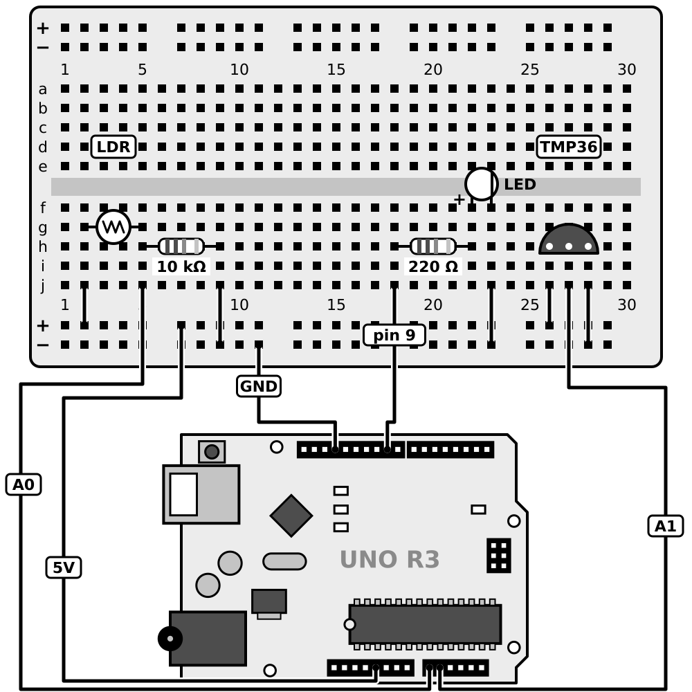
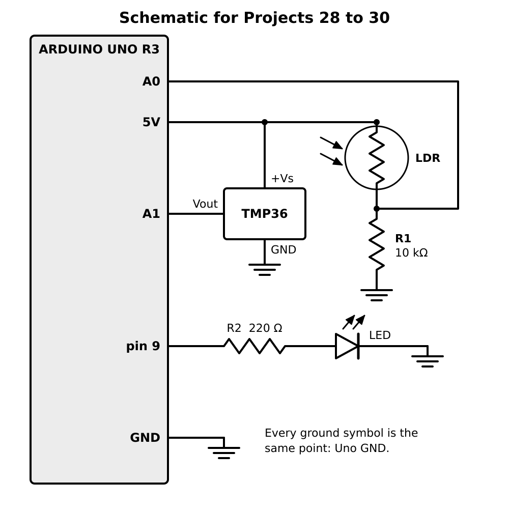

# Project 30: Serial Plotter Logger

Book chapter: 6

## What it does

A Serial Plotter logger. About five times a second it prints the light
percent, the temperature, and the alarm limit as
Light:n,TempC:n.n,Limit:n.n for the Arduino IDE Serial Plotter. It
keeps the Project 29 deadband alarm on pin 9.

## Bill of materials

| Qty | Part | Suggested part |
|---|---|---|
| 1 | Arduino Uno R3 | Arduino A000066 |
| 1 | USB cable, type A to type B | Any USB 2.0 A-to-B cable that carries data, about 1 m |
| 1 | Breadboard, half size, 400 tie points | BusBoard BB400 |
| 1 | Photocell (light dependent resistor, LDR), 2 legs | SparkFun SEN-09088 (mini photocell) |
| 1 | Resistor, 10 k ohm, 1/4 W, 5% | Yageo CFR-25JT-52-10K |
| 1 | Temperature sensor, TMP36, TO-92 package, 3 legs | Analog Devices TMP36GT9Z |
| 1 | LED, 5 mm, any color | Kingbright WP7113ID (red) |
| 1 | Resistor, 220 ohm, 1/4 W, 5% | Yageo CFR-25JT-52-220R |
| 10 | Jumper wires, pin to pin | BusBoard ZW-MM-10 (ribbon of 40, 10 cm) |

## Wiring

*Wiring diagram (book Figure 6.7)*

*Schematic (book Figure 6.8)*

- LDR (photocell): one leg in g2, the other in g5
- Resistor 10 k ohm: h5 to h9
- Wires: j2 to plus rail, j9 to ground rail
- Wire: Uno pin A0 to j5
- Wire: Uno 5V to plus rail
- Wire: ground rail to Uno GND
- Resistor 220 ohm: h18 to h22
- LED: long leg f22, short leg f23
- Wire: Uno pin 9 to j18
- Wire: j23 to ground rail
- TMP36: legs in h26, h27, h28, flat face toward row j (left leg +Vs, middle Vout, right GND)
- Wires: j26 to plus rail, j28 to ground rail
- Wire: Uno pin A1 to j27

## Upload
1. Open the .ino file in Arduino IDE 2.
2. Select Arduino Uno and its port.
3. Click Upload.

Then open the Serial Plotter (Tools, Serial Plotter) and set it to 9600
baud.

## What you should see

The Serial Plotter shows three labeled traces. Covering the LDR drops
the Light trace. Warming the TMP36 raises TempC toward the flat Limit
line, and the lamp lights when it crosses.

## Change it

Add a fourth trace named Alarm that is 100 while the alarm is on and 0
while it is off.
