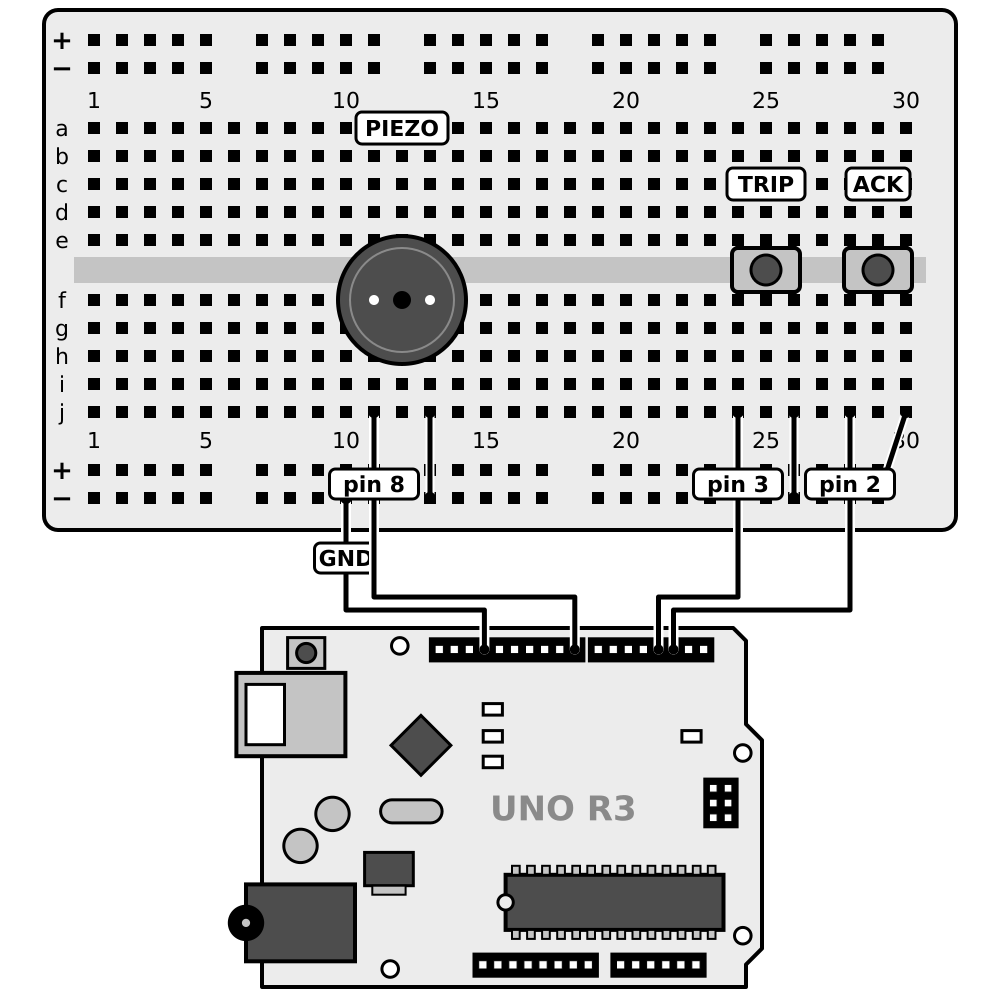
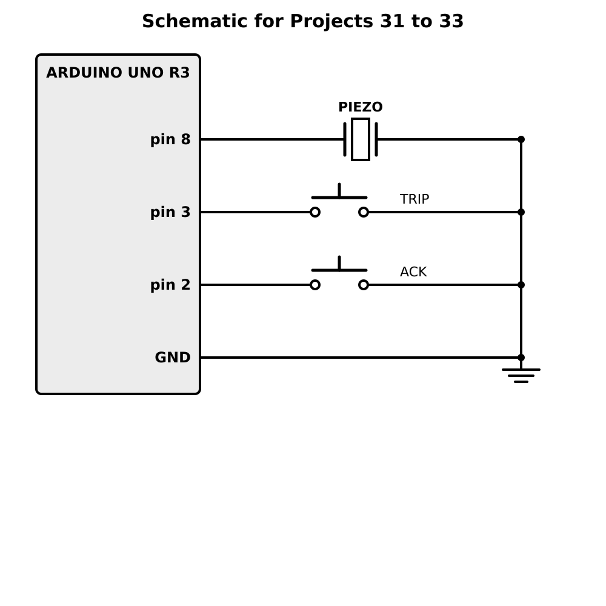

# Project 31: Alarm Horn with Acknowledge

Book chapter: 7

## What it does

An alarm annunciator. Holding TRIP (pin 3, INPUT_PULLUP) is the alarm.
The piezo on pin 8 warbles between 880 and 660 Hz and the built-in LED
flashes until you press ACK (pin 2). Then the horn stops and the LED
stays steady until TRIP is released. It uses tone() and noTone(). The
loop runs every 250 ms.

## Bill of materials

| Qty | Part | Suggested part |
|---|---|---|
| 1 | Arduino Uno R3 | Arduino A000066 |
| 1 | USB cable, type A to type B | Any USB 2.0 A-to-B cable that carries data, about 1 m |
| 1 | Breadboard, half size, 400 tie points | BusBoard BB400 |
| 1 | Piezo buzzer, passive type (no built-in tone), 2 pins 5 mm apart | TDK PS1240P02BT |
| 2 | Pushbutton, tactile, 6 x 6 mm, 4 legs | Omron B3F-1000 |
| 7 | Jumper wires, pin to pin | BusBoard ZW-MM-10 (ribbon of 40, 10 cm) |

## Wiring

*Wiring diagram (book Figure 7.2)*

*Schematic (book Figure 7.3)*

- Piezo buzzer (passive): pins in f11 and f13
- Wire: Uno pin 8 to j11
- Wire: j13 to ground rail
- Wire: ground rail to Uno GND
- Button across the trench: legs e24, f24, e26, f26
- Wire: Uno pin 3 to j24
- Wire: j26 to ground rail
- Button across the trench: legs e28, f28, e30, f30
- Wire: Uno pin 2 to j28
- Wire: j30 to ground rail

The button on pin 3 is TRIP and the button on pin 2 is ACK. The lamp is
the built-in LED on pin 13.

## Upload
1. Open the .ino file in Arduino IDE 2.
2. Select Arduino Uno and its port.
3. Click Upload.

## What you should see

- Hold TRIP: the horn warbles and the L LED flashes.
- Press ACK while holding TRIP: the horn goes silent and the LED is
  steady.
- Release TRIP: the LED goes off.

You may need to hold ACK for up to a quarter second, because the
buttons are read four times a second. That is intended and is discussed
in the book.

## Change it

Make the alarm latch until it has been acknowledged.
