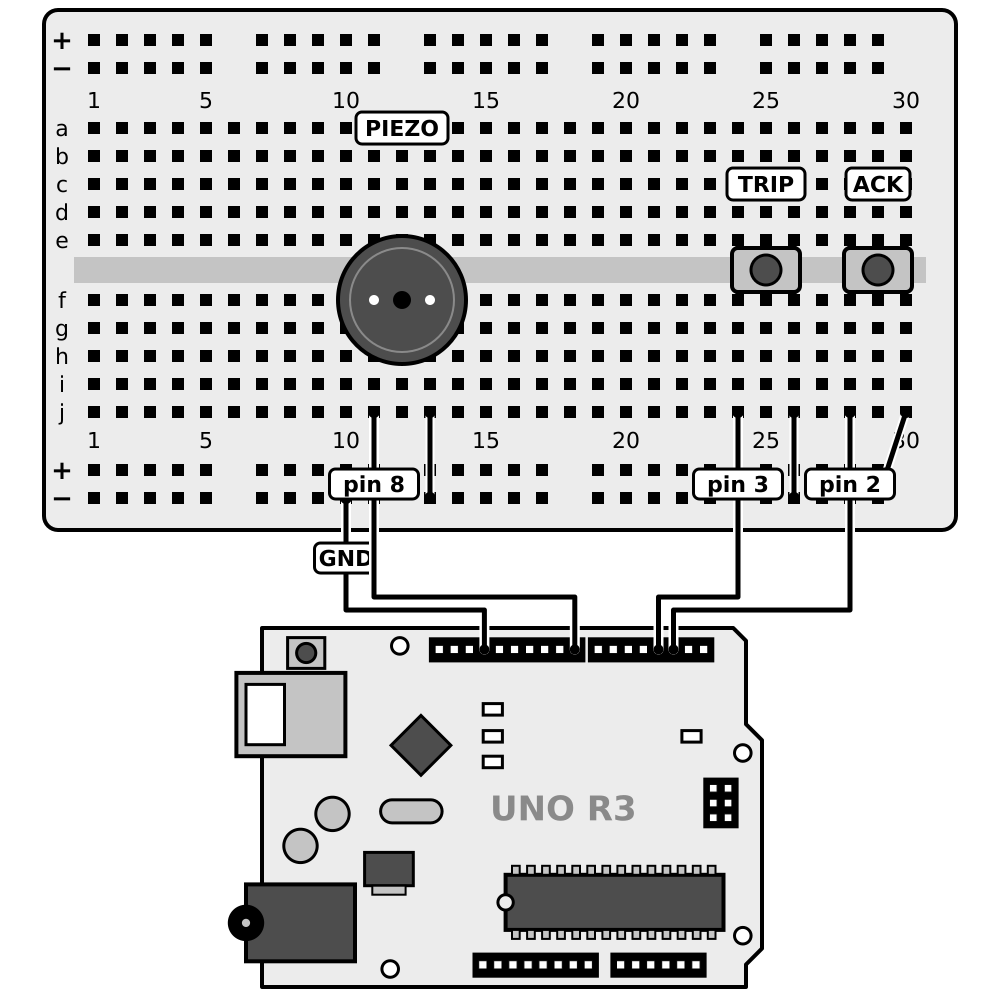
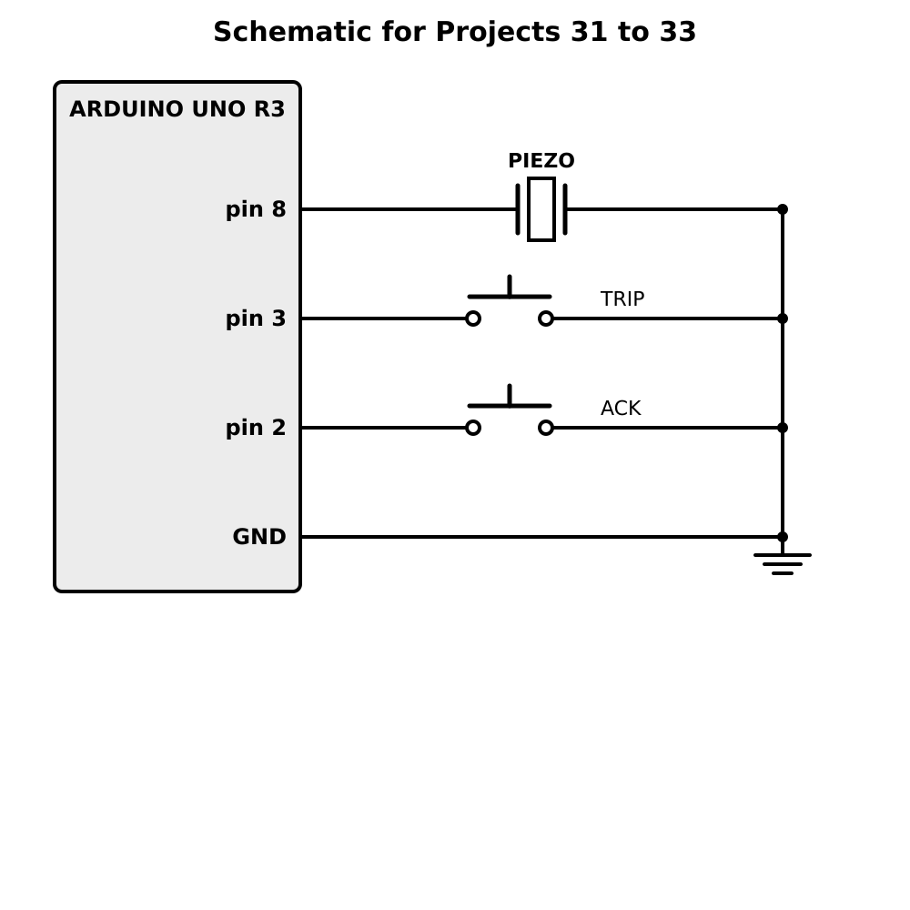

# Project 32: Scale

Book chapter: 7

## What it does

Plays the C major scale, C4 to C5, up and back down with a
play(frequency, ms) function. The note frequencies are NOTE_ constants.

## Bill of materials

| Qty | Part | Suggested part |
|---|---|---|
| 1 | Arduino Uno R3 | Arduino A000066 |
| 1 | USB cable, type A to type B | Any USB 2.0 A-to-B cable that carries data, about 1 m |
| 1 | Breadboard, half size, 400 tie points | BusBoard BB400 |
| 1 | Piezo buzzer, passive type (no built-in tone), 2 pins 5 mm apart | TDK PS1240P02BT |
| 3 | Jumper wires, pin to pin | BusBoard ZW-MM-10 (ribbon of 40, 10 cm) |

## Wiring

*Wiring diagram (book Figure 7.2)*

*Schematic (book Figure 7.3)*

The drawing also shows the two buttons left on the board from Project
31. This sketch does not use them, so they are not in the bill of
materials above.

- Piezo buzzer (passive): pins in f11 and f13
- Wire: Uno pin 8 to j11
- Wire: j13 to ground rail
- Wire: ground rail to Uno GND

## Upload
1. Open the .ino file in Arduino IDE 2.
2. Select Arduino Uno and its port.
3. Click Upload.

## What you should see

Eight rising notes and seven falling notes, then a 1.5 s pause,
repeating.

## Change it

Play the scale one octave higher by doubling every frequency.
