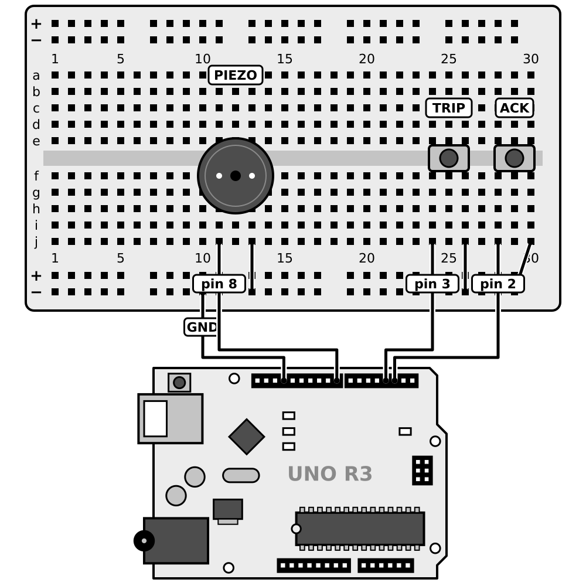
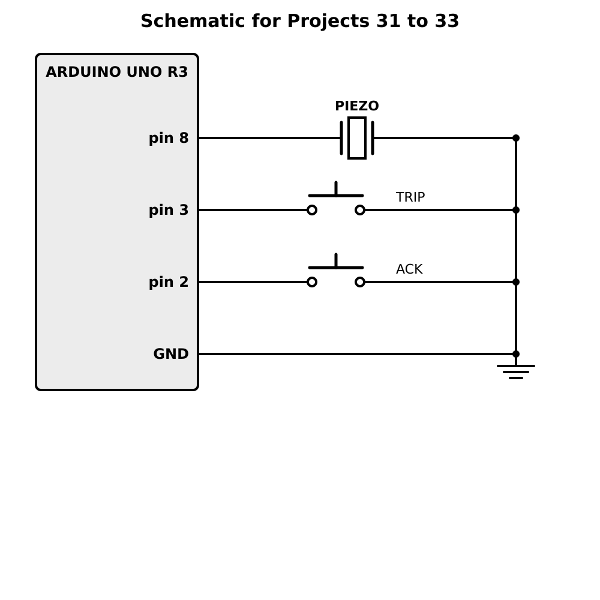

# Project 33: Melody

Book chapter: 7

## What it does

Plays the first two lines of Ode to Joy (Beethoven, 1824, public
domain). Note lengths are counted in eighth notes and scaled by the
EIGHTH constant (200 ms). The eleven notes that both lines share are in
a function, opening().

## Bill of materials

| Qty | Part | Suggested part |
|---|---|---|
| 1 | Arduino Uno R3 | Arduino A000066 |
| 1 | USB cable, type A to type B | Any USB 2.0 A-to-B cable that carries data, about 1 m |
| 1 | Breadboard, half size, 400 tie points | BusBoard BB400 |
| 1 | Piezo buzzer, passive type (no built-in tone), 2 pins 5 mm apart | TDK PS1240P02BT |
| 3 | Jumper wires, pin to pin | BusBoard ZW-MM-10 (ribbon of 40, 10 cm) |

## Wiring

*Wiring diagram (book Figure 7.2)*

*Schematic (book Figure 7.3)*

The drawing also shows the two buttons left on the board from Project
31. This sketch does not use them, so they are not in the bill of
materials above.

- Piezo buzzer (passive): pins in f11 and f13
- Wire: Uno pin 8 to j11
- Wire: j13 to ground rail
- Wire: ground rail to Uno GND

## Upload
1. Open the .ino file in Arduino IDE 2.
2. Select Arduino Uno and its port.
3. Click Upload.

## What you should see

The tune plays in about 13 seconds, rests 2 seconds, and repeats.

## Change it

Change EIGHTH to find the tempo you like best.
