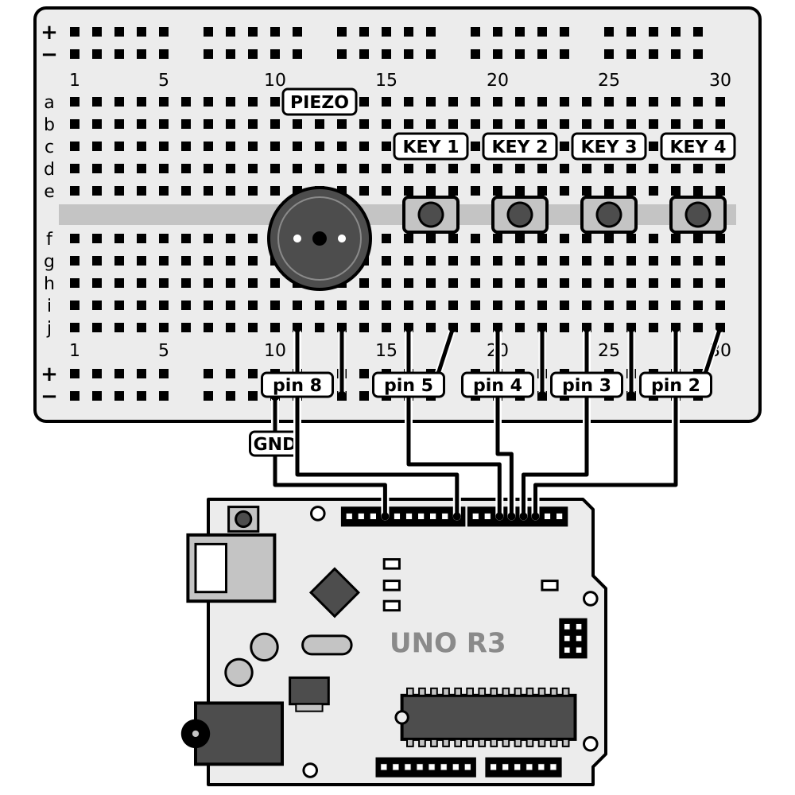
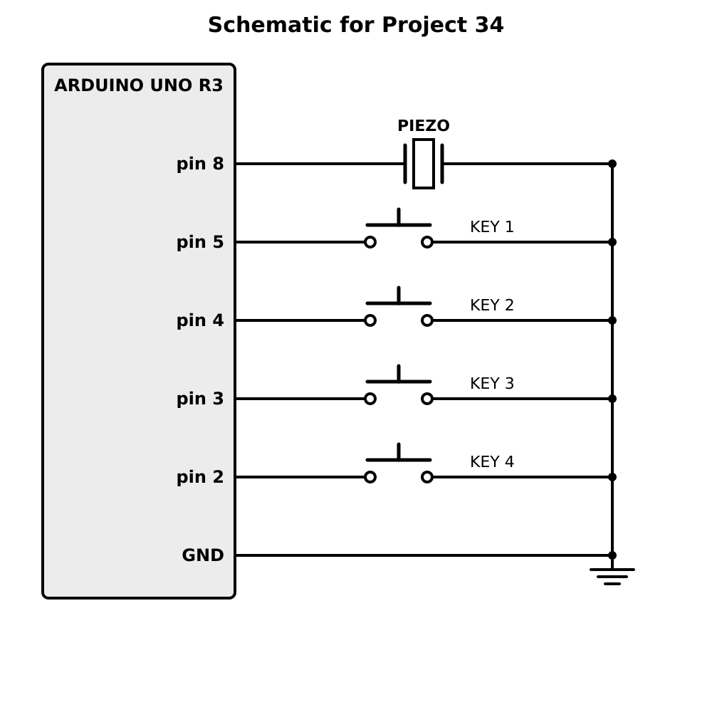

# Project 34: Button Piano

Book chapter: 7

## What it does

A four-key piano. Buttons on pins 5, 4, 3, and 2 (INPUT_PULLUP) play
C4, D4, E4, and G4 on the piezo while held. An if / else if chain gives
the left-most held key priority.

## Bill of materials

| Qty | Part | Suggested part |
|---|---|---|
| 1 | Arduino Uno R3 | Arduino A000066 |
| 1 | USB cable, type A to type B | Any USB 2.0 A-to-B cable that carries data, about 1 m |
| 1 | Breadboard, half size, 400 tie points | BusBoard BB400 |
| 1 | Piezo buzzer, passive type (no built-in tone), 2 pins 5 mm apart | TDK PS1240P02BT |
| 4 | Pushbutton, tactile, 6 x 6 mm, 4 legs | Omron B3F-1000 |
| 11 | Jumper wires, pin to pin | BusBoard ZW-MM-10 (ribbon of 40, 10 cm) |

## Wiring

*Wiring diagram (book Figure 7.7)*

*Schematic (book Figure 7.8)*

- Piezo buzzer (passive): pins in f11 and f13
- Wire: Uno pin 8 to j11
- Wire: j13 to ground rail
- Wire: ground rail to Uno GND
- Button across the trench: legs e16, f16, e18, f18
- Wire: Uno pin 5 to j16
- Wire: j18 to ground rail
- Button across the trench: legs e20, f20, e22, f22
- Wire: Uno pin 4 to j20
- Wire: j22 to ground rail
- Button across the trench: legs e24, f24, e26, f26
- Wire: Uno pin 3 to j24
- Wire: j26 to ground rail
- Button across the trench: legs e28, f28, e30, f30
- Wire: Uno pin 2 to j28
- Wire: j30 to ground rail

Keys left to right: KEY 1 pin 5, KEY 2 pin 4, KEY 3 pin 3, KEY 4 pin 2.

## Upload
1. Open the .ino file in Arduino IDE 2.
2. Select Arduino Uno and its port.
3. Click Upload.

## What you should see

Each key sounds its note while held. With two keys down, you hear the
one further left.

## Change it

Reverse the priority so that the right-hand key wins.
