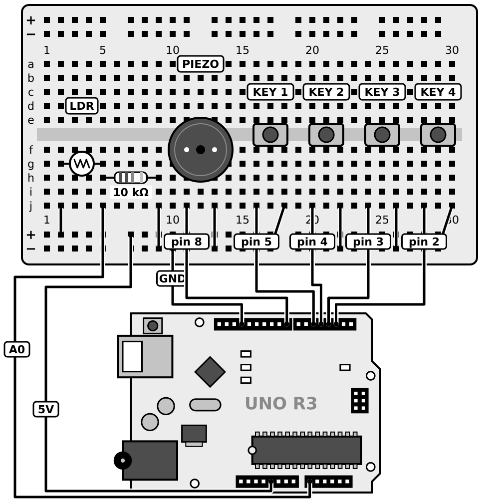
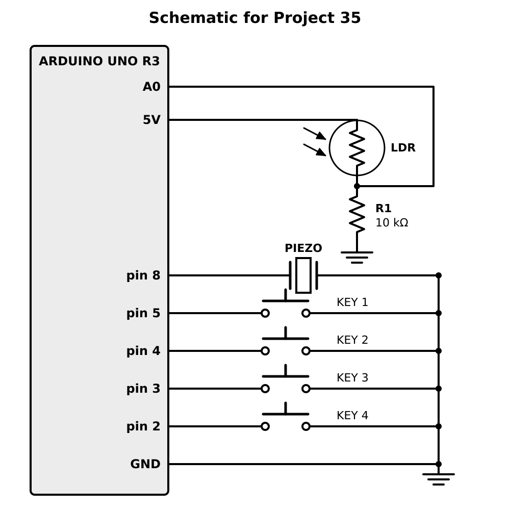

# Project 35: Light Theremin

Book chapter: 7

## What it does

A light theremin. While the button on pin 2 is held, the LDR reading on
A0 is scaled with map() and constrain() to 200 to 1500 Hz and played
with tone(). DARK and BRIGHT are calibration constants you measure
yourself.

## Bill of materials

| Qty | Part | Suggested part |
|---|---|---|
| 1 | Arduino Uno R3 | Arduino A000066 |
| 1 | USB cable, type A to type B | Any USB 2.0 A-to-B cable that carries data, about 1 m |
| 1 | Breadboard, half size, 400 tie points | BusBoard BB400 |
| 1 | Piezo buzzer, passive type (no built-in tone), 2 pins 5 mm apart | TDK PS1240P02BT |
| 1 | Pushbutton, tactile, 6 x 6 mm, 4 legs | Omron B3F-1000 |
| 1 | Photocell (light dependent resistor, LDR), 2 legs | SparkFun SEN-09088 (mini photocell) |
| 1 | Resistor, 10 k ohm, 1/4 W, 5% | Yageo CFR-25JT-52-10K |
| 9 | Jumper wires, pin to pin | BusBoard ZW-MM-10 (ribbon of 40, 10 cm) |

## Wiring

*Wiring diagram (book Figure 7.9)*

*Schematic (book Figure 7.10)*

The drawing also shows parts left on the board from Project 34. This
sketch does not use them, so they are not in the bill of materials
above.

- Piezo buzzer (passive): pins in f11 and f13
- Wire: Uno pin 8 to j11
- Wire: j13 to ground rail
- Wire: ground rail to Uno GND
- Button across the trench: legs e28, f28, e30, f30
- Wire: Uno pin 2 to j28
- Wire: j30 to ground rail
- LDR (photocell): one leg in g2, the other in g5
- Resistor 10 k ohm: h5 to h9
- Wires: j2 to plus rail, j9 to ground rail
- Wire: Uno pin A0 to j5
- Wire: Uno 5V to plus rail

## Upload
1. Open the .ino file in Arduino IDE 2.
2. Select Arduino Uno and its port.
3. Click Upload.

## What you should see

Hold the button and move a hand over the LDR. The pitch falls as your
hand comes down and rises as it lifts. Releasing the button stops the
sound.

Replace DARK (200) and BRIGHT (700) in the sketch with your own
readings: one with the sensor covered, one in normal room light.

## Change it

Swap LOW_NOTE and HIGH_NOTE in the map line so the pitch falls as your
hand lifts.
